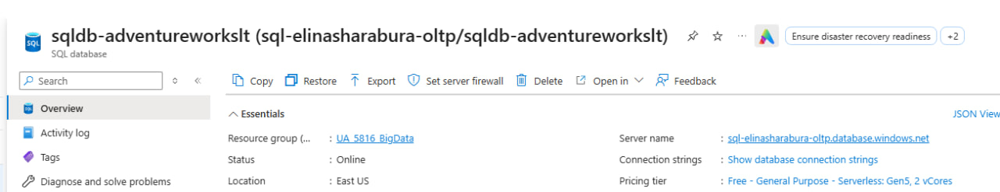
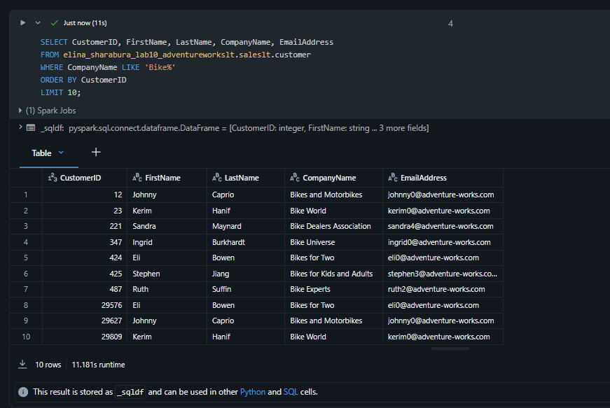
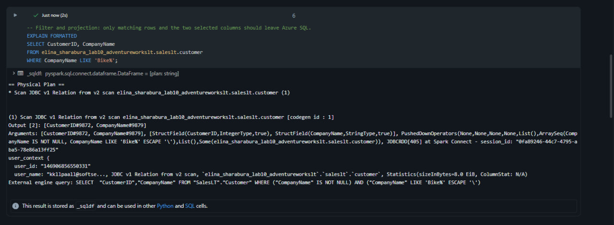
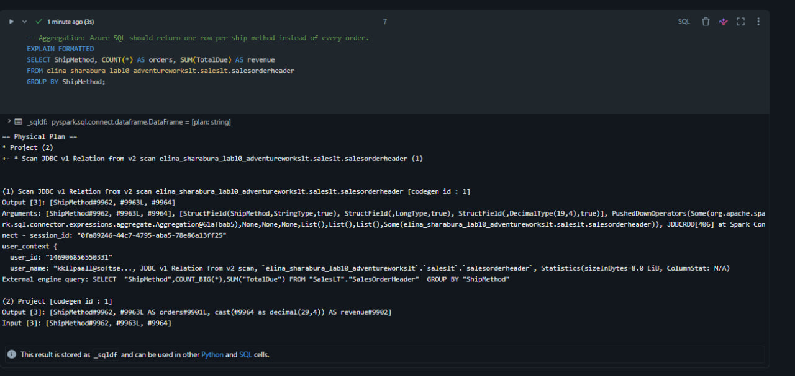
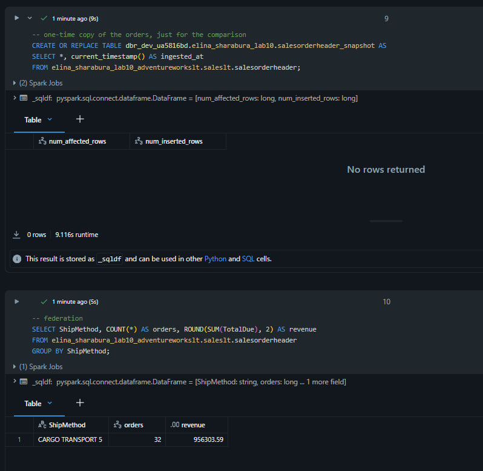
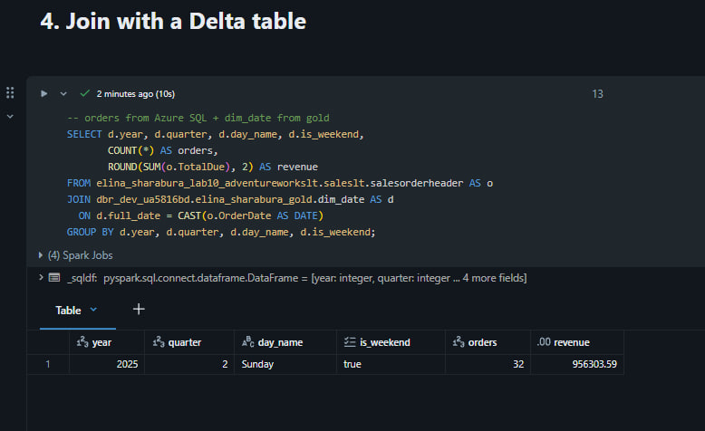
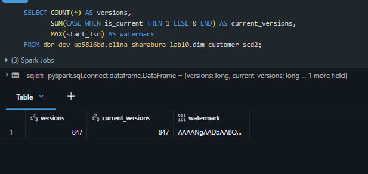
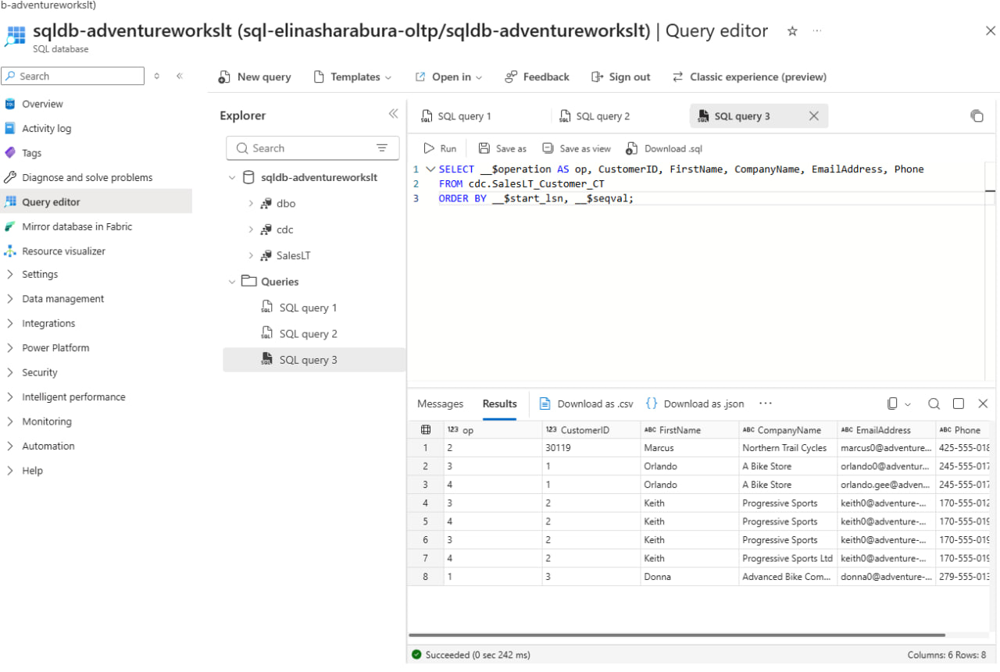
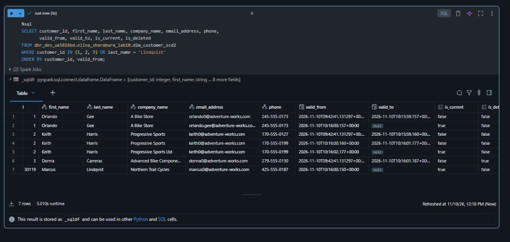
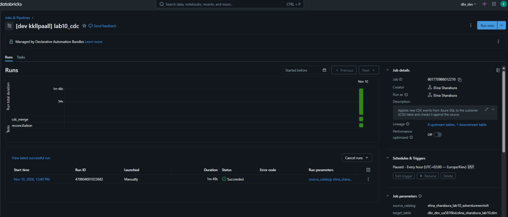

# Lab 10: External Operational Databases: Lakehouse Federation & CDC

An Azure SQL database with the AdventureWorksLT sample plays the operational database of a shop.
Part A queries it from Databricks in place through Lakehouse Federation.
Part B captures customer changes with SQL Server CDC and applies them incrementally to an SCD2 table.

## Environment

| | |
|---|---|
| Source | Azure SQL `sql-elinasharabura-oltp`, database `sqldb-adventureworkslt` (free offer, serverless, East US, `UA_5816_BigData`) |
| Connection | `elina_sharabura_lab10_azure_sql_conn`, type `sqlserver` |
| Foreign catalog | `elina_sharabura_lab10_adventureworkslt` |
| Delta tables | `dbr_dev_ua5816bd.elina_sharabura_lab10` |

## Structure

```
lab10/
├── databricks.yml                  # bundle with the CDC job
├── resources/lab10_cdc.job.yml     # job: cdc_merge, then reconciliation
├── sql/                            # run in the Azure SQL Query editor
│   ├── 01_shift_order_dates.sql    # sample orders moved from 2008 to 2025 to match dim_date
│   ├── 02_create_reader_user.sql   # read-only user for the connection
│   ├── 03_enable_cdc.sql           # CDC on the database and SalesLT.Customer
│   └── 04_simulate_changes.sql     # insert, updates and a delete for the demo
└── notebooks/                      # run in Databricks
    ├── 00_setup.sql                # connection, foreign catalog, schema, SCD2 table (once)
    ├── 01_federation.sql           # Part A
    ├── 02_cdc_initial_load.sql     # first load of the current customers (once)
    ├── 03_cdc_merge.py             # Part B, job task
    └── 04_reconciliation.py        # target vs source check, job task
```

## Source

- AdventureWorksLT is the OLTP version of the sample, so it fits the role of an operational database.
  The DW version is already an analytical model and is not offered as a sample in Azure SQL.
- Order dates are moved 17 years forward (2008 to 2025) so they fall into my `dim_date` (2020-2030).
  This is done before CDC is enabled, so the shift is not captured as changes.
- Databricks connects as `databricks_reader`: `db_datareader` plus read access to the `cdc` schema.
  The password is in Key Vault `kvua5816bd` and gets to the connection through `secret()`.
- CDC tracks `SalesLT.Customer` without `PasswordHash` and `PasswordSalt`, so they never reach the lakehouse.



## Part A: Lakehouse Federation

- **Query.** External tables are read with plain SQL through the foreign catalog, e.g. customers from Azure SQL filtered by company name.
- **Pushdown.** `EXPLAIN FORMATTED` shows the SQL sent to Azure SQL in `External engine query`.
  Both the filter (`LIKE 'Bike%'` with two columns) and the aggregation (`GROUP BY ShipMethod` with `COUNT` and `SUM`)
  ran in Azure SQL. Databricks only renamed the columns.
- **Federation vs Delta.** `salesorderheader_snapshot` is a one-time copy with `ingested_at`.
  The same query returns the same result on both (32 orders, 956303.59). First run: federation 6 s, Delta 22 s
  (cold table right after creation). Second run: about 5 s each. With 32 rows the time is overhead, not data.
- **Join.** Federated `salesorderheader` joined with `dim_date` from my gold layer on `full_date`:
  all 32 orders fall on Sunday, 2025-06-01, Q2.







### Discussion

| | Federation | Ingestion |
|---|---|---|
| Freshness | live | as fresh as the last load |
| Load on the source | every query | only during the load |
| History | none | Delta history, SCD |
| Fits | ad hoc checks, small lookups | dashboards, heavy joins, large tables |

**Latency.** Every query goes over the network to Azure SQL, and the paused serverless database has to wake up first.
Pushdown keeps the transferred data small.

**Security.** Credentials are stored in the connection, the password comes from Key Vault, the database user is read-only,
access in Databricks goes through Unity Catalog grants. Weak spot: "Allow Azure services" on the firewall,
in production it would be a private endpoint.


## Part B: CDC

1. `02_cdc_initial_load` loads the 847 current customers once, because CDC only has changes made after it was enabled.
   The last LSN from `cdc.lsn_time_mapping` is saved as the start position.
2. `03_cdc_merge` reads events from `cdc.saleslt_customer_ct` with an LSN above the watermark, takes the commit time
   from `cdc.lsn_time_mapping` and skips operation 3 (old value of an update).
3. Events are ordered per customer by LSN. The first event closes the open version in the target.
   Every insert and update becomes a new version, closed by the next event in the same batch if there is one.
   A delete closes the version and sets `is_deleted` (soft delete, the history stays).
4. A closed version ends 1 second before the next one starts, as in Lab 4.
5. It is one MERGE. The watermark is the largest `start_lsn` / `end_lsn` in the table itself, so new versions and
   the position are written in one transaction. A rerun finds nothing new and changes nothing.
6. `04_reconciliation` compares current versions with the live source through federation (`EXCEPT` both ways)
   and fails on any difference.

**Demo** (`04_simulate_changes.sql`):

| Change in Azure SQL | Result in `dim_customer_scd2` |
|---|---|
| new customer 30119 Marcus Lindqvist | new current version |
| customer 1: new email | old version closed, new one current |
| customer 2: new phone, then new company | 3 versions, both changes kept |
| customer 3: deleted | version closed, `is_deleted = true` |

A second merge run gave the same 7 rows. Reconciliation passed with 0 differences.






**Job** `lab10_cdc` in the bundle runs `cdc_merge`, then `reconciliation` on GP1, hourly schedule paused.




### Discussion

**Batch vs CDC.** A full reload moves the whole table and a deleted row just disappears.
CDC moves only changed rows and delivers deletes as events, but needs a watermark and ordering.

**Slowly changing dimensions.** In Lab 4 SCD2 was built by comparing snapshots, here it is built from change events,
so deletes are visible and several changes between runs become separate versions (customer 2).

**Late-arriving data.** Events are applied in LSN order, the commit order in the source, so a backlog is still applied correctly.
CDC keeps changes for 3 days by default: if the pipeline stops for longer, a new initial load is needed.

