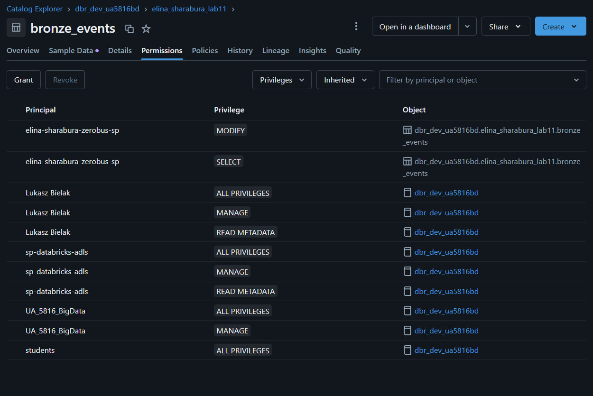
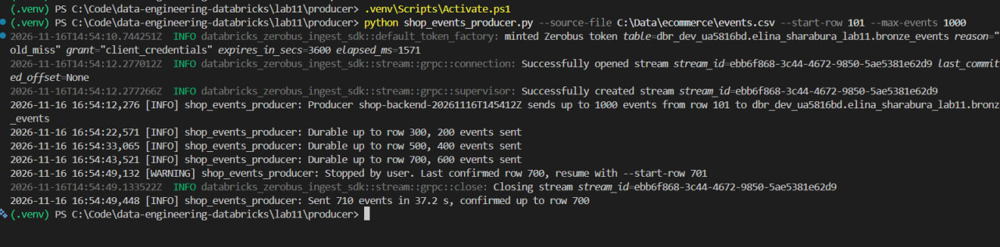
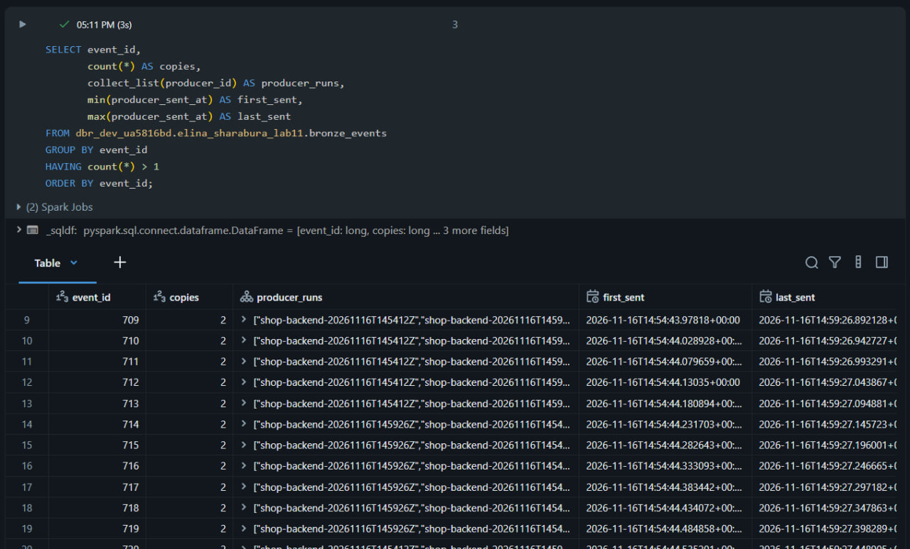
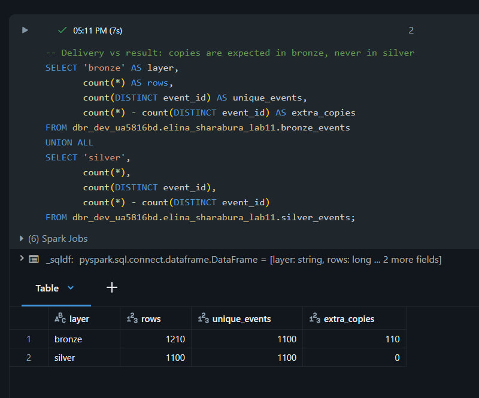
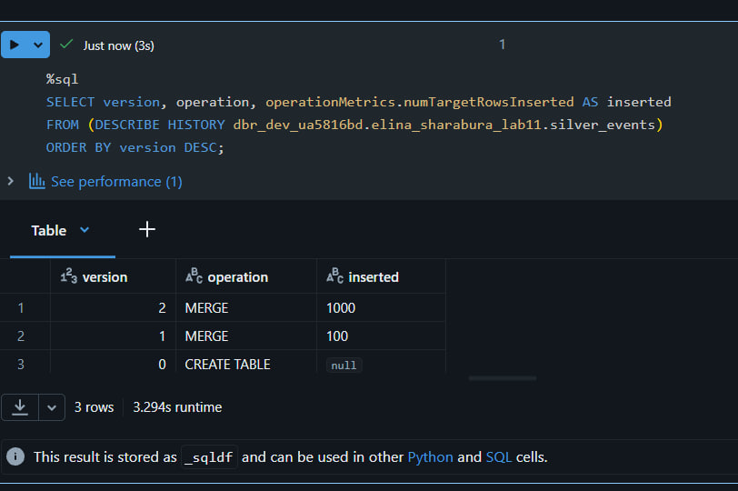
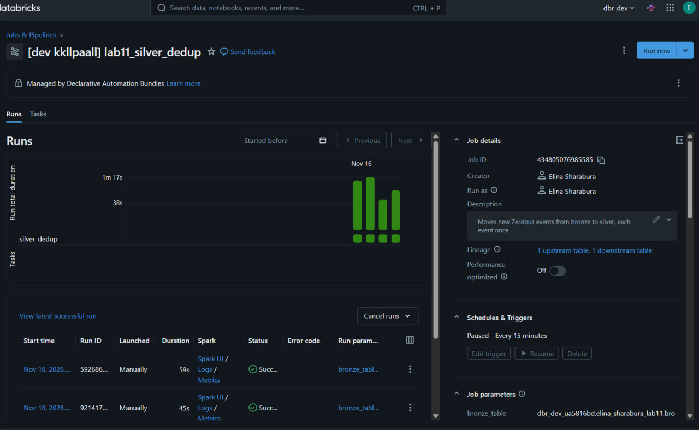

# Lab 11:  Zero-Bus Streaming with Zerobus

Shop clickstream events go from a producer straight into a Unity Catalog Delta table through Zerobus
with no message bus in between. A job then moves them to silver so that every event is there exactly once,
even when the producer sends some of them twice.

## Environment

| | |
|---|---|
| Tables | `dbr_dev_ua5816bd.elina_sharabura_lab11`: `bronze_events`, `silver_events`, volume `checkpoints` |
| Producer identity | service principal `elina-sharabura-zerobus-sp` (Databricks managed, OAuth secret) |
| Source | `events.csv` from the e-commerce dataset (760,958 events, 2020-2025) |

## Structure

```
lab11/
├── databricks.yml                     # bundle with the silver job
├── resources/lab11_silver_dedup.job.yml
├── producer/                          # runs on the laptop, not in Databricks
│   ├── shop_events_producer.py
│   ├── requirements.txt
│   └── .env.example                   # real .env with the secret is ignored by git
└── notebooks/
    ├── 00_setup.sql                   # schema, tables, volume, grants (once)
    ├── 01_silver_dedup.py             # bronze to silver, job task
    └── 02_validation.sql              # duplicates, lost records, reconciliation, latency
```

## Source

- The producer plays the shop backend: every row of `events.csv` is sent as one event, 20 events per second,
  so it behaves like live traffic and not like a file upload.
- `event_id` is unique in the source (760,958 rows, 760,958 ids), so any duplicate in bronze comes from delivery, not from the data.
- Times in the file have no zone and are treated as UTC.
- Rows are ordered by `event_id`, not by time, so events from 2020 and 2025 arrive next to each other (late events).
- The data is the same shop as in the batch labs. Lab 3 loaded it as files with Auto Loader, here the same events arrive as a stream.

## Producer

- Runs outside Databricks: the producer is an external system.
- Config and the secret come from `.env` (ignored by git), run options from arguments: file, start row, number of events, rate.
- Each csv row becomes one JSON record matching the bronze schema. The original row is kept in `raw_payload` (VARIANT).
- Every record carries `producer_id` (one per run), `producer_seq` (1..n inside a run) and `producer_sent_at`.
- `ingest_record_offset` only queues the record, the SDK sends it and waits for acks in the background.
  Every 200 records the producer waits for the last offset and logs the row it is durable up to.
  That row is where a restarted producer continues from.
- `NonRetriableException` (credentials, grants, schema) stops the producer with a clear message, the stream is always closed in `finally`.



## Security

- A separate service principal only for the producer.
- Grants: `USE CATALOG`, `USE SCHEMA` and `MODIFY, SELECT` on `bronze_events` only. Nothing on silver or the volume.
- The secret was first scoped to `zerobus` only, but SDK 1.11 always asks for an `all-apis` token, so the stream was refused (403).
  The secret now has `all-apis`. Access is still limited by the entitlements and the table grants.

## Idempotent processing

Zerobus delivers at least once: an event can arrive twice, for example after a producer restart or a lost ack.
It is handled on three levels:

1. **Producer.** `event_id` comes from the source, so a resent copy has the same id. A new id per send would make duplicates impossible to find.
2. **Bronze.** Append-only, keeps every delivery. It is the log of what actually arrived.
3. **Silver.** `01_silver_dedup` reads only new bronze rows (Structured Streaming with a checkpoint, `availableNow`).
   Copies inside one micro-batch are removed with `row_number` (the first arrival is kept),
   copies that arrive later are skipped by an insert-only MERGE on `event_id`.

The MERGE only compares with silver rows that arrived in the last 7 days (`dedup_window_days`),
so its cost doesn't grow with the whole table. A resent copy arrives seconds or minutes after the original.
A copy that comes later than the window would get through. That is the trade-off: deduplication is guaranteed inside the window.
Silver is clustered by `producer_sent_at` for the same reason: duplicates are close in arrival time, not in event time.

**Demo**

| Step | Bronze | Silver |
|---|---|---|
| run 1: rows 1-100 | 100 rows | 100 rows after the job |
| run 2: from row 101, stopped with Ctrl+C. Sent rows 101-810, durable up to row 700 | 810 rows | 100 rows |
| run 3: restart from row 701 up to row 1100 | 1210 rows, 1100 unique, 110 copies (events 701-810) | 100 rows |
| silver job | no change | 1100 rows, 1100 unique, MERGE inserted 1000 |
| silver job again, no new data | no change | no new version |

- Every duplicate has two producer runs: the stopped one and the restart.
- No lost records: `producer_seq` has no gaps in any run.
- Reconciliation: 0 events missing in silver, 0 unknown events in silver.






**Job** `lab11_silver_dedup` in the bundle runs `01_silver_dedup` on GP1 every 15 minutes, schedule paused.
`max_concurrent_runs: 1`, because two runs on one checkpoint would break the stream.
The setup notebook is not part of the job.



## Latency

From `producer_sent_at` to the commit of the Delta file with the row: p50 1.6 s, p95 3.8 s, max 4.2 s (1210 records).

## Kafka-style vs zero-bus

In Lab 3 events went through Event Hub (Kafka surface): producer, Event Hub `elina-sharabura-eventhub`,
a Spark consumer with a checkpoint, then Delta. Here the producer writes to the table and nothing runs in between.

| | Bus (Lab 3, Event Hub) | Zero-bus (Lab 11, Zerobus) |
|---|---|---|
| Path | producer, Event Hub, Spark consumer, Delta | producer, Delta |
| Components to run | namespace and hub, consumer job on a cluster, its checkpoint | producer only |
| Sinks | many: any number of consumers can read the same topic | one: the lakehouse, others read Delta |
| Replay | from the topic, within retention | from bronze (`raw_payload`) |
| If the writer side is slow or down | events wait in the topic | producer keeps unacked records and retries |
| Delivery | at least once | at least once |
| Schema | consumer parses raw JSON | the table is the contract, checked on ingest |
| Credentials | SAS connection strings (send and listen policies) | OAuth service principal and table grants |
| Cost | hub billed all the time + compute of the consumer | serverless, billed by usage |

**What happened in Lab 3.** The hub had 1 hour retention. The consumer started after the messages had expired
and read 0 rows. With a bus the data lives in the topic only for the retention time, and somebody has to read it in time.
With Zerobus there is no such gap, the event is in the table a few seconds after it was sent.

### Discussion

**Event-driven pipelines.** Both designs react to events as they happen instead of waiting for a batch.
Zerobus shortens the path: the event is queryable in seconds without running a consumer.

**Decoupled systems.** The bus gives stronger decoupling: the producer knows only the topic,
and new consumers (a microservice, alerts, search) can be added without touching it.
With Zerobus the producer knows the table and its schema, and a schema change has to be done on both sides.
When the lakehouse is the only destination, this coupling costs little and removes a whole layer.

**Cost and operations.** The bus means a namespace, partitions, retention, consumer groups,
a streaming job and its checkpoint to look after. Zerobus moves most of that to Databricks.
What stays is the service principal, its secret rotation and keeping the producer in line with the table schema.
Duplicates don't go away in either design, the silver job is still needed.

**When to pick which.** A bus when several systems need the same events, when replay from the stream matters,
or when producers must not know about the lakehouse. Zerobus when the lakehouse is the only sink and there are many
small producers (apps, IoT) that should push data without extra infrastructure.