# Lab 12: AI Capstone, RAG and AI-assisted development

A knowledge assistant for an engineering team that builds an online shop on Saleor.
It answers questions about checkout, orders, payments, discounts, stock and taxes
from the Saleor developer documentation and cites the pages it used.

## Environment

| | |
|---|---|
| Workspace | personal Databricks Free Edition, serverless compute only |
| Schema | `workspace.elina_sharabura_lab12` |
| Search | AI Search (formerly Vector Search) endpoint `elina-sharabura-lab12`, Standard |
| Models | embeddings `databricks-gte-large-en` (1024 dims), answers `databricks-meta-llama-3-3-70b-instruct`, judge `databricks-gpt-oss-120b` |

## Structure

```
lab12/
├── databricks.yml                    # bundle variables: corpus, chunking, models
├── resources/lab12_rag.job.yml       # refresh job and evaluate job
├── eval/eval_set.json                # 20 questions with reference answers
├── src/saleor_rag/                   # code shared by the notebooks, no Spark inside
│   ├── mdx.py                        # front matter, MDX cleaning
│   ├── chunking.py                   # split by headings, pack paragraphs with overlap
│   ├── prompts.py                    # system prompts, numbered excerpts, refusal phrase
│   ├── assistant.py                  # retrieve, prompt, ask the LLM, log row
│   └── judge.py                      # judge prompt and strict parsing of its verdict
└── notebooks/
    ├── 00_setup.py                   # schema, volume, tables (once)
    ├── 00_create_search_index.py     # endpoint and index (once)
    ├── 00_grants.py                  # access for readers (once)
    ├── 01_ingest_docs.py             # job task
    ├── 02_chunk_docs.py              # job task
    ├── 03_embed_chunks.py            # job task
    ├── 04_sync_index.py              # job task
    ├── 05_ask.py                     # one question, logged
    └── 06_evaluate.py                # evaluate job
```

# Part A: RAG on Databricks

## Dataset

Saleor developer documentation from [saleor/saleor-docs](https://github.com/saleor/saleor-docs) (BSD-3-Clause, Saleor Commerce).

- Pinned to commit `1ba3c43`, so every run reads the same pages and evaluation runs can be compared.
- Only the shop logic part of `docs/developer`: 16 topics (checkout, order, payments, discounts, gift cards, shipping, stock, taxes, channels, products, ...), 66 `.mdx` pages.
- Left out: the generated API reference, changelogs, app store and developer tooling pages.

## Ingest

`01_ingest_docs` takes the file list of the commit from the GitHub API and downloads the selected pages.

- Raw files go to the volume `raw_docs` as they are, one folder per commit. Parsing can be changed later without downloading again.
- A file already in the volume is not downloaded again. A download is written as `.part` first and renamed when complete,
  so a broken download is never taken for a finished file.
- `documents` has one row per page: `doc_id` (path, e.g. `checkout/lifecycle`), `topic`, `title`, raw text, `source_url` (the page on GitHub at the commit) and `source_commit`.
- Written with MERGE: new pages are inserted, changed pages updated, pages that left the corpus deleted.
- The run fails if a topic is missing at the commit or GitHub returns a truncated file list.

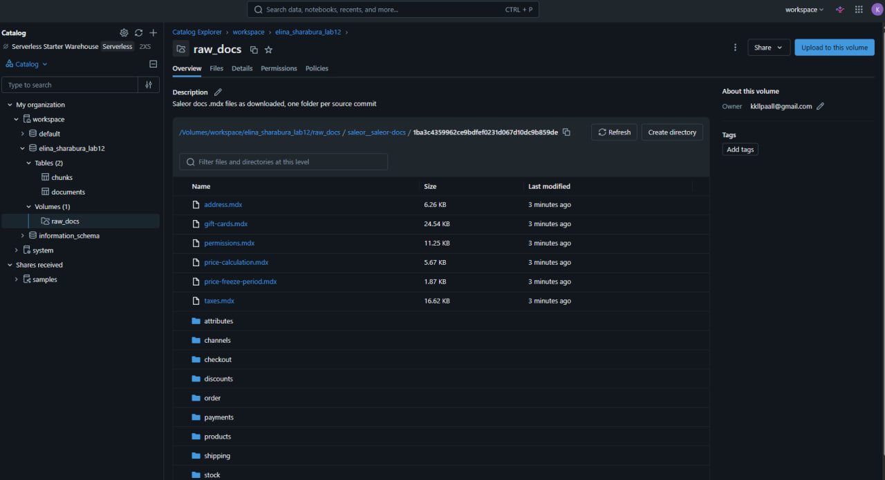
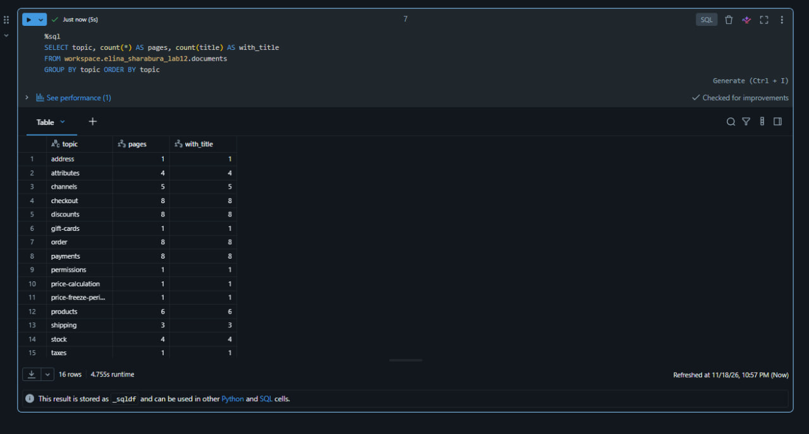
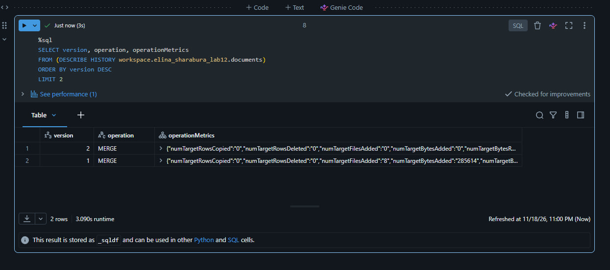

## Cleaning and chunking

`02_chunk_docs` with the code from `src/saleor_rag`.

**Cleaning.** The pages are MDX. Before splitting:

| Found in the pages | Done |
|---|---|
| `<Tabs>`, `<Tab value="Mutation">` (389) | tag removed, the value kept as a label `Mutation:` |
| `:::note`, `:::warning` blocks (167) | kept as `Note: ...`, `Warning: ...` |
| links, images | link text kept, url and images removed |
| `json` code blocks (307, about 20% of all text) | removed: response examples, long and without facts of their own |
| `mermaid` blocks (33) | removed: diagram source |
| `graphql` blocks (196) | kept: they name the mutations and fields people ask about |

Without this, some chunks were only a JSON response and came up for any API question.

**Chunking.**
- Split by headings. Lines starting with `#` inside code blocks are comments, not headings.
- Whole paragraphs packed up to 1500 characters (about 375 tokens). A code block is never split unless it is longer than a chunk.
- Overlap: the last paragraphs of a chunk, up to 200 characters, start the next one, so a fact on the border is whole in at least one chunk.
- Every chunk starts with `page title > section`, so it reads on its own and the title is part of its vector.
- Pieces under 30 characters are dropped. With 80 a whole short page (`channels/troubleshooting`) disappeared.
- `chunk_id` is `doc_id#0003`, the same between runs. `content_hash` (sha256 of the text) tells when the text changed.

Result: 771 chunks from 66 pages, length min 66, median 545, max 1619 characters.

The MERGE into `chunks` clears the vector of a chunk whose text changed, keeps the vector when only the commit changed, and deletes chunks that are gone.

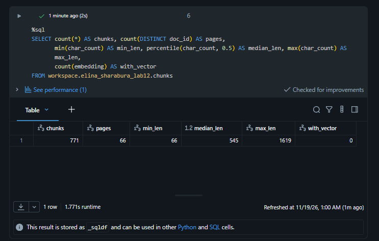

## Embeddings and storage

Self-managed embeddings: `03_embed_chunks` computes the vectors and stores them in the `chunks` table itself, next to the text.

- Only chunks without a vector are embedded, so a rerun with no changes calls the model zero times.
- `ai_query('databricks-gte-large-en', chunk_text)` in Spark. The vectors are collected once and then merged,
  so the model is not called twice for one chunk.
- Every vector is checked to have 1024 numbers before anything is written.
- `embedding_model` and `embedded_at` are stored per row, so it is known which model made a vector.
- The MERGE matches on `chunk_id` and `content_hash`, so a vector is never attached to text that changed meanwhile.
- `chunks` is a Unity Catalog Delta table with Change Data Feed, the source of the search index.

Why self-managed and not managed embeddings: the vectors are our governed data. The index or the endpoint can be deleted
and rebuilt from the table without paying for embeddings again, and a model change can be seen and rolled out per row.

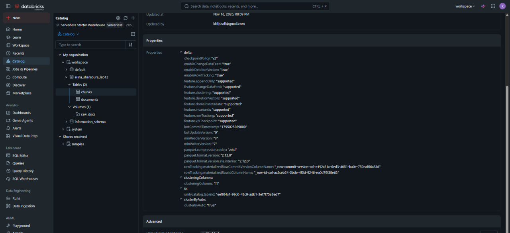
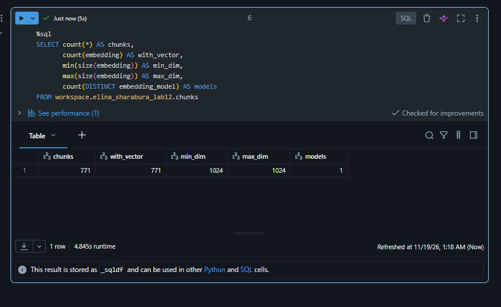
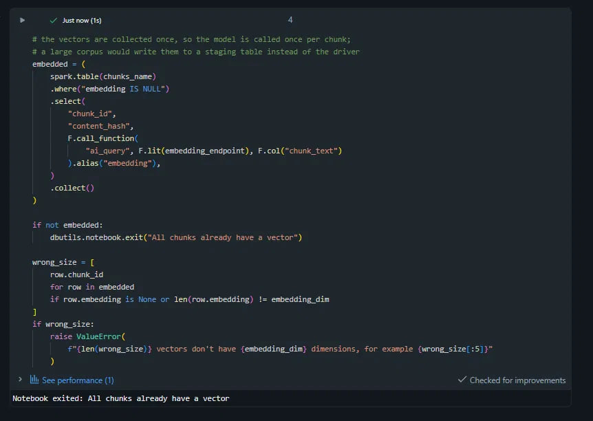

## Search index and retrieval

`00_create_search_index` (once) creates the endpoint and a Delta Sync index `chunks_index`:
primary key `chunk_id`, vectors from the `embedding` column, `TRIGGERED` sync,
synced columns `chunk_id, doc_id, topic, title, section, chunk_text, source_url`.

- `TRIGGERED`, not `CONTINUOUS`: the docs change rarely, the refresh job syncs after new vectors.
- `04_sync_index` starts a sync, waits for exactly this sync to finish and checks that the index row count equals the chunks with a vector.
- The question is embedded with the same endpoint as the chunks, otherwise the distances mean nothing.
- Retrieval returns the top 5 chunks and can be limited to one topic with a metadata filter (`{"topic": "checkout"}`).

The score is computed from the distance between the vectors. The gte vectors are long, so the scores are small (around 0.004).
Only their order matters, so a fixed score threshold would have to be tuned on this data first.

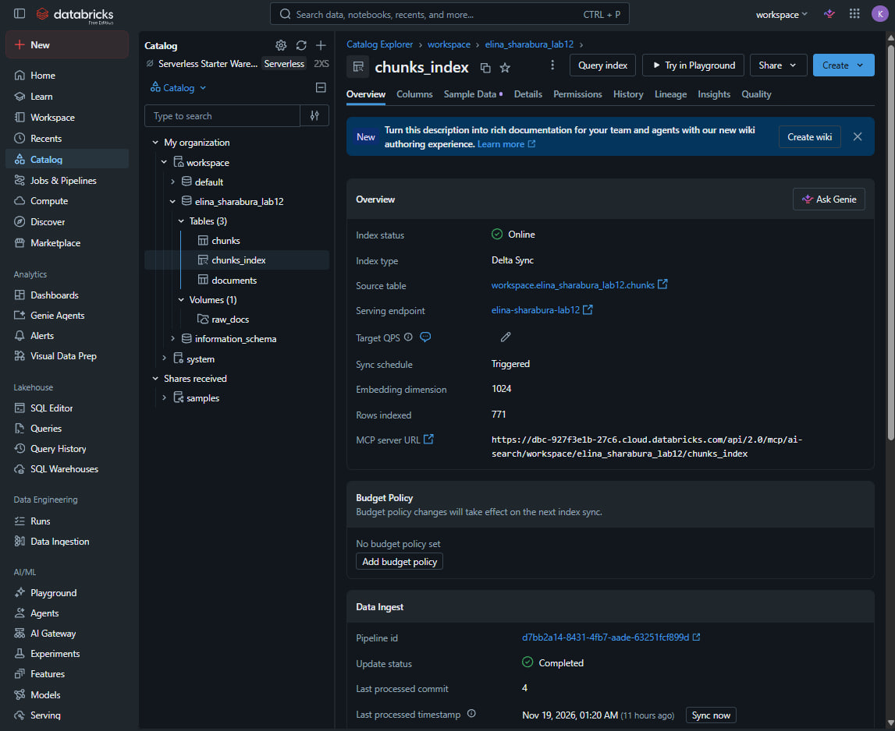
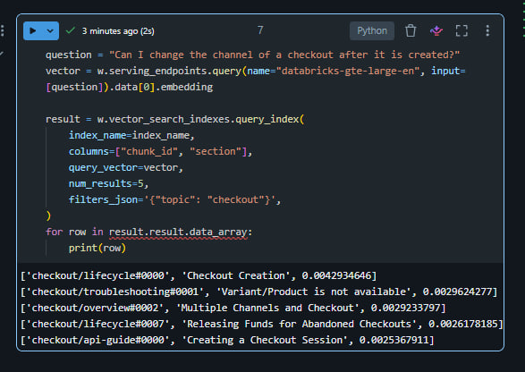

## Question answering

`Assistant` in `src/saleor_rag/assistant.py`, used by `05_ask` and by the evaluation:

1. embed the question, top-k chunks from the index (optionally inside one topic);
2. prompt: rules + numbered excerpts `[1]..[5]` + the question;
3. Llama 3.3 70B, temperature 0, at most 600 tokens.

The rules: use only the excerpts, cite them as `[n]`, and if they don't hold the answer reply exactly
`I can't answer this from the Saleor documentation.` A fixed phrase lets refusals be counted.

| Question | Answer |
|---|---|
| Can I change the channel of a checkout after it is created? | "No, the channel of a checkout cannot be changed after it is created [1]." with `checkout/lifecycle#0000` as [1] |
| What is the capital of Australia? | refusal. Search still returned 5 chunks: it always returns the closest ones, not only relevant ones |
| the channel question, filter `topic = taxes` | refusal, all 5 chunks from taxes |

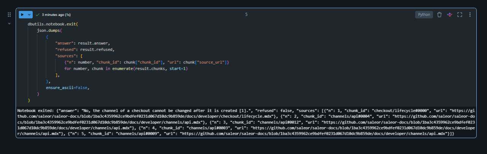
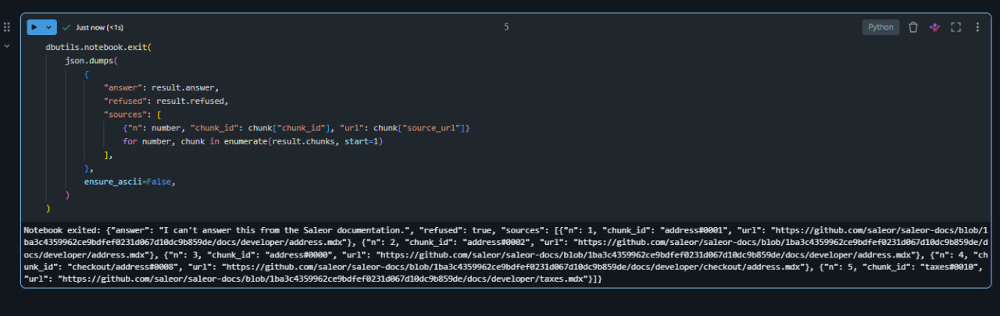
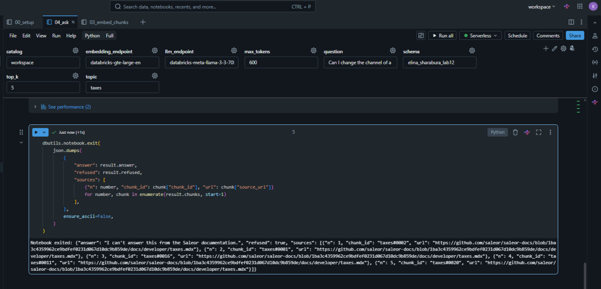

## Evaluation

`06_evaluate` (job `lab12_rag_evaluate`).

**Eval set** (`eval/eval_set.json`, copied to the table `eval_set`): 20 questions written from the pages of the corpus.
16 have an answer on one page (`expected_doc_id`), 4 are not covered by the corpus (Docker deployment, App SDK, migration from Shopify, product limits),
there the right behaviour is a refusal.

Every question is answered twice with the same LLM: with retrieval (`rag`) and without (`no_retrieval`).
The baseline gets the same refusal option, so the comparison measures retrieval and not the instructions.
A judge from another model family (`gpt-oss-120b`) scores every answer from 1 to 5:

- correctness, against the reference answer;
- relevance, to the question;
- groundedness, every claim supported by the excerpts (only `rag`, not for refusals).

From the data: `behavior_correct` (an answerable question answered, an unanswerable one refused)
and `expected_doc_rank` (position of the expected page in the top 5).
Answers go to `assistant_log` (`source = eval`), scores to `eval_runs`, both under one `run_id`, written only when the whole run succeeded.

| | no_retrieval | rag |
|---|---|---|
| correctness (16 answerable) | 1.88 | 5.00 |
| relevance | 4.15 | 5.00 |
| groundedness | | 5.00 |
| answered a question the docs don't cover (of 4) | 4 | 0 |
| refused a question the docs answer | 0 | 0 |
| expected page at rank 1 / in top 5 | | 1.00 / 1.00 |

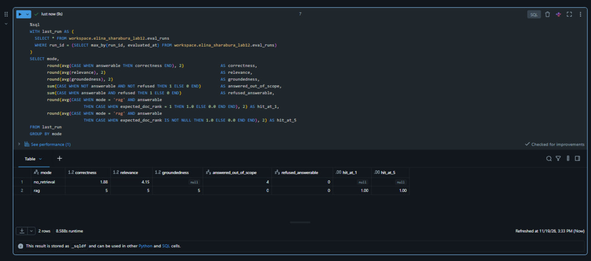

**Hallucination risk.** Without retrieval the model answered on topic (relevance above 4) and confidently wrong:

| Question | Without retrieval | Docs |
|---|---|---|
| when are checkouts without lines deleted | after 7 days | after 6 hours |
| how to attach a guest checkout to a user | mutation `associate_user` | `checkoutCustomerAttach` |
| permission to create a warehouse | "Manage warehouses" | `MANAGE_PRODUCTS` |
| when are expired orders deleted | 30 days, from 0 to 365 | 60 days, from 1 to 120 |

Wrong numbers, invented API names and statements opposite to the docs. It also never refused: all 4 questions outside the corpus
got detailed instructions, for example a built-in Shopify migration tool that is not documented. With retrieval all 4 were refused.

**Missing context.** No answerable question was refused and the expected page was always found, so this set shows no missing context.

**Human review.** The judge's scores were read next to the answers. One refusal got groundedness 1 and other refusals got null,
although a refusal makes no claims. The rule "no groundedness for refusals" is now in code, not left to the judge.

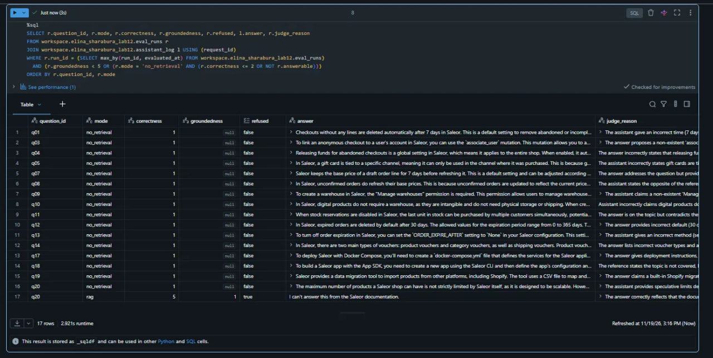

**Limitations.**
- The questions were written from the page text, so they are close to its wording. Real users ask in other words.
- Every answer is on one page, there are no questions that need several pages.
- 20 questions is a small set, one question is 6% of the score.
- LLM output is not fully deterministic even at temperature 0: between two runs `no_retrieval` correctness moved from 1.75 to 1.88
  and relevance from 4.40 to 4.15, `rag` stayed at 5. Small differences are noise, the gap between the modes is not.

## Logging, monitoring and access

`assistant_log` keeps every question: who and when, mode, topic filter, retrieved chunk ids and scores,
the full prompt, answer, refusal, model, tokens and latency. A bad answer can be traced to what was retrieved and what the model saw.

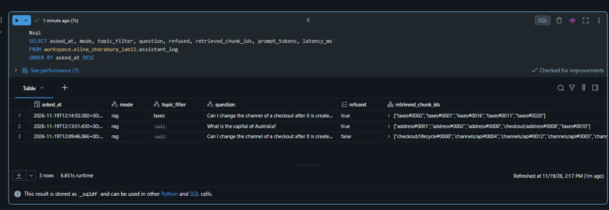

`00_grants` gives the readers group (`account users`) only what searching needs:

| Object | Readers |
|---|---|
| schema | `USE SCHEMA` |
| `chunks_index`, `chunks` | `SELECT` |
| `raw_docs`, `documents`, `eval_set`, `eval_runs` | nothing |
| `assistant_log` | nothing: it holds the questions people ask |

Free Edition has one user, so access could only be checked with `SHOW GRANTS`, not by logging in as a reader.

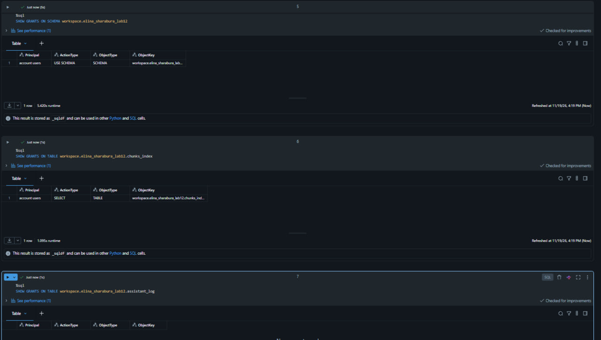

## Jobs

| Job | Tasks | When |
|---|---|---|
| `lab12_rag_refresh` | ingest, chunk, embed, sync index | Mondays 6:00, schedule paused |
| `lab12_rag_evaluate` | evaluate | after changes to data, prompts or models |

Loading and evaluation are separate jobs: evaluation is the quality check and costs 80 model calls.
All parameters come from bundle variables. The `00_` notebooks create objects and are not part of any job.
Serverless compute, `max_concurrent_runs: 1`, email to the deploying user on failure.

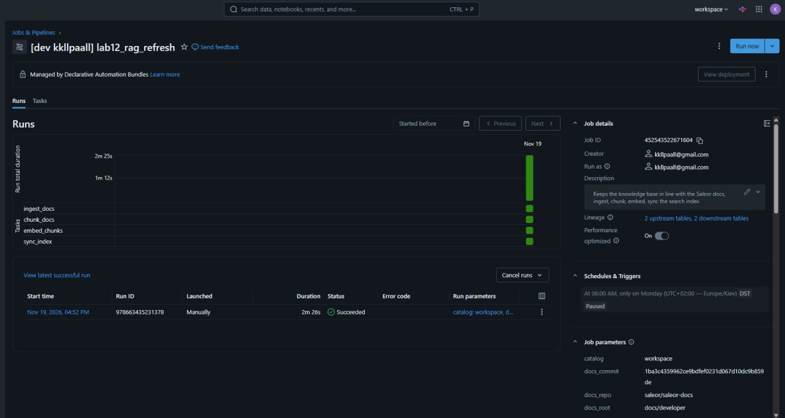
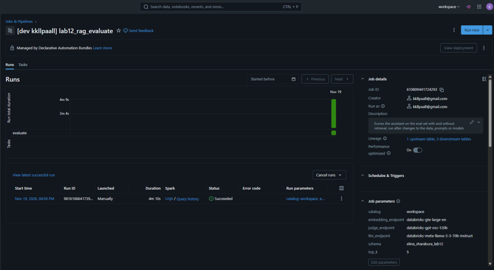

## Discussion

**Why RAG beats prompting alone.** The model knows Saleor in general, but not its exact settings, defaults, limits and mutation names,
and it does not say when it doesn't know. With retrieval correctness went from 1.88 to 5.00,
answers outside the docs went from 4 of 4 to 0, and every answer cites a page at a fixed commit that can be checked.
New docs need a new sync, not a new model.

**Chunk size vs retrieval quality.**
- Small chunks match a precise question closely and cost fewer tokens, but can cut an answer that spans paragraphs.
- Large chunks keep the context, but their vector is a mix of several topics, they match less precisely and fill the prompt.
- Here: about 375 tokens, cut at paragraphs and headings, with overlap and the page and section on top.
  Removing the JSON examples mattered as much as the size: noise chunks pushed real answers out of the top 5.
- Only one size was evaluated. With hit@1 already 1.00 this set could not show a difference between sizes. A harder set would be needed first.

**Governance.** Every step is a Unity Catalog object: raw files, pages, chunks with vectors, index, log and evaluation.
An answer is traceable from `assistant_log` through the chunk ids to the page, section and commit.
Readers can search but can't see the raw data or other people's questions.
The question log is personal data: in production it would get a retention rule (DELETE and VACUUM) and a row filter so a user sees only their own questions.

**Cost.**
- In a paid workspace the search endpoint is billed per hour while it exists, used or not.
  Here it was created only after the vectors were ready, the same habit that keeps that bill low. On Free Edition it takes the one endpoint the workspace allows.
- Vectors are stored, a rerun embeds only new or changed chunks, and the index syncs only changed rows (CDF, triggered).
- One RAG answer has about 805 prompt tokens with 5 chunks, a no-retrieval answer about 94: retrieval makes the prompt 8 times longer, that is the price of grounded answers.
- Latency is the same in both modes, about 1.3 s, so embedding the question and the search add little next to the LLM call.
- Evaluation is a separate job run on demand, not on every refresh.

# Part B: AI-assisted development with the Databricks AI Dev Kit

To be added.