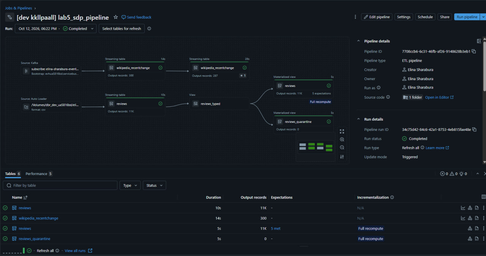
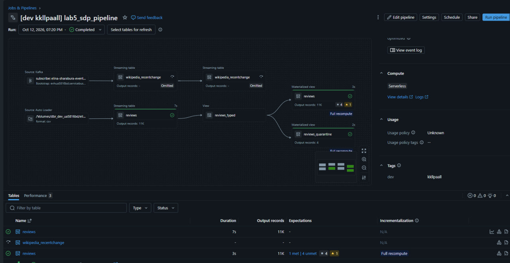
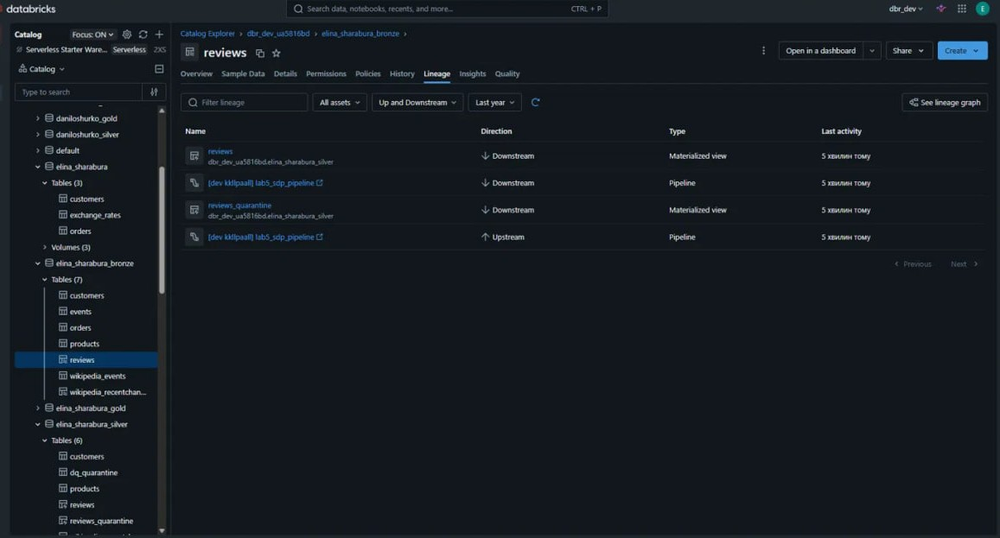
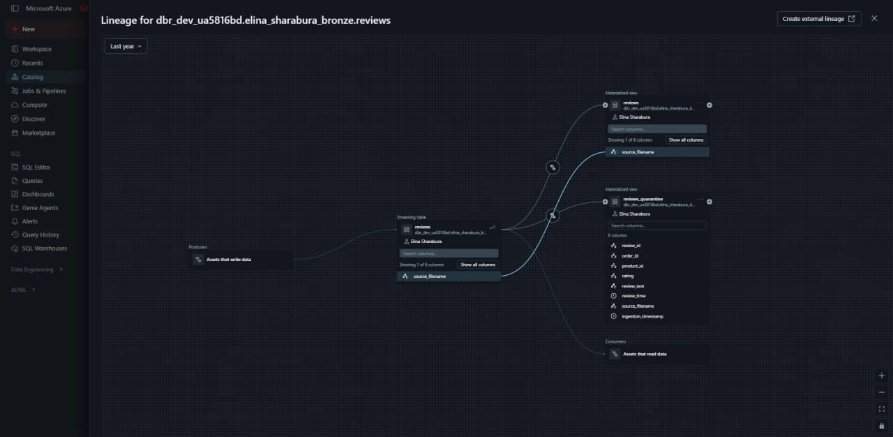
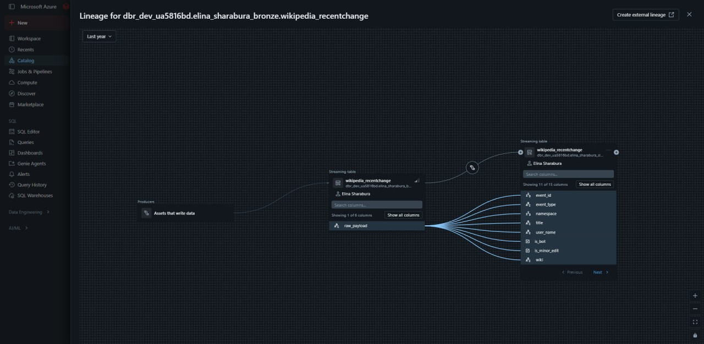

# Lab 5 — Lakeflow Spark Declarative Pipelines

A declarative pipeline that ingests a **streaming source** (Wikipedia edits via Azure Event Hub) and a **CSV source** (product reviews via Auto Loader) into Bronze, validates them into Silver with **expectations**, and is deployed with a **Databricks Asset Bundle**.

## Architecture

```
Wikipedia EventStreams ──► producer (local laptop) ──► Azure Event Hub
                                                          │ Kafka endpoint, Listen key from Key Vault
                                                          ▼
                          bronze.wikipedia_recentchange (streaming table)
                                                          ▼
                          silver.wikipedia_recentchange (streaming table, expectations, deduplication)

/Volumes/.../raw_data/reviews/*.csv ──► bronze.reviews (streaming table, Auto Loader)
                                                          ▼
                                       reviews_typed (temporary view, try_cast)
                                          ├──► silver.reviews            (materialized view, expectations)
                                          └──► silver.reviews_quarantine (materialized view, rejected rows)
```

| Table | Type | Schema |
|---|---|---|
| `wikipedia_recentchange` | Streaming table | `elina_sharabura_bronze` |
| `reviews` | Streaming table | `elina_sharabura_bronze` |
| `wikipedia_recentchange` | Streaming table | `elina_sharabura_silver` |
| `reviews` | Materialized view | `elina_sharabura_silver` |
| `reviews_quarantine` | Materialized view | `elina_sharabura_silver` |




## Project structure

```
lab5/
├── databricks.yml               # bundle: variables, dev target
├── resources/
│   └── lab5_pipeline.yml        # pipeline definition: catalog, schema, serverless, configuration
├── src/transformations/         # pipeline code, one file per dataset
│   ├── bronze_wikipedia.py
│   ├── bronze_reviews.py
│   ├── silver_wikipedia.py
│   └── silver_reviews.py
├── producer/                    # external producer, runs outside Databricks
│   ├── wikipedia_producer.py
│   └── requirements.txt
├── test_data/
│   └── reviews_002.csv          # synthetic rows that break each data-quality rule 
└── screenshots/
```

## Sources

### Streaming — Azure Event Hub
- `producer/wikipedia_producer.py` reads the public Wikimedia `recentchange` stream and sends events in size-based batches to Event Hub `elina-sharabura-eventhub`.
- The producer runs **on a laptop, outside Databricks**, as an external system would (review feedback from Lab 3). It uses a **Send-only** key from an environment variable; the pipeline uses a separate **Listen-only** key from Key Vault through the secret scope `elina_sharabura-personal-scope`.


### CSV — Auto Loader
- `reviews.csv` (10 780 rows) lies in its own folder `raw_data/reviews/`, so Auto Loader picks up only this dataset.
- All columns stay `string` in Bronze; typing happens in Silver.
- `escape = '"'` follows RFC 4180 (quotes inside quoted values are doubled), `schemaEvolutionMode = rescue` puts unknown columns into `_rescued_data` instead of stopping the pipeline.

## Data quality (expectations)

| Rule | Table | Action | Why this action |
|---|---|---|---|
| `valid_review_id` | silver.reviews | **FAIL** | Primary key; a missing id means a broken file, not a bad row |
| `valid_rating` (1–5) | silver.reviews | **DROP** | Out-of-scale rating is useless for analytics |
| `has_order_and_product` | silver.reviews | **DROP** | Review not linked to an order or product |
| `valid_review_time` | silver.reviews | **DROP** | Cannot be used in time-based reporting |
| `has_review_text` | silver.reviews | **WARN** | Rating-only reviews are valid, but we want to track them |
| `parsable_payload` | silver.wikipedia | **DROP** | `from_json` returned NULL / event without id |
| `has_title`, `has_wiki`, `valid_event_time` | silver.wikipedia | **DROP** | Event without these fields has no analytical value |
| `known_event_type` | silver.wikipedia | **WARN** | Wikimedia may add new types; notice them without losing data |

Design decisions:
- **`try_cast` / `from_json` instead of failing casts** — malformed values become NULL and are caught by expectations, so bad data becomes a data-quality metric instead of a pipeline failure.
- **Quarantine** — rows rejected by the DROP rules of reviews are kept in `silver.reviews_quarantine`. Both silver and quarantine read the rules from one dictionary, so they cannot drift apart. The quarantine condition is wrapped in `coalesce(..., false)`: otherwise `NOT(NULL)` would hide a row from both tables.
- **No quarantine for Wikipedia** — Bronze already keeps the full original JSON, so any rejected event can be investigated there.
- **No FAIL rule on the live stream** — one odd event must not stop the whole streaming pipeline.

Test file `test_data/reviews_002.csv` contains one valid row and one row breaking each rule. Result: silver.reviews **+2**, quarantine **4**, every rule except `valid_review_id` registered a violation.

## Safe reload

| Mechanism | Where | Purpose |
|---|---|---|
| Streaming checkpoints | all streaming tables | A normal run reads only new events / new files |
| `pipelines.reset.allowed = false` + `delta.appendOnly = true` | bronze.wikipedia | Event Hub keeps events for 1 hour only, so this data cannot be re-read; a full refresh must never truncate it (UI shows **"Reset not allowed"**) |
| Full refresh allowed | bronze.reviews | Source files stay in the volume, so the table can always be rebuilt from them |
| Selective full refresh | any table | Rebuild only what changed, leave the rest untouched |


Rule: protect from reset only what cannot be reproduced from its source.

**What was done:** a failed `--full-refresh-all` cleared the Auto Loader checkpoint of bronze.reviews but could not truncate it (`appendOnly`), so the next run re-ingested both files — the pipeline was green, the duplicates were found only through event-log metrics (`num_output_rows = 10 786` instead of 6). Fixed by allowing reset on bronze.reviews (its files are replayable) and running a **selective full refresh** of the reviews branch only; the Wikipedia branch stayed untouched. Result: bronze.reviews 10 786 rows (both files exactly once), silver.reviews 10 782, quarantine 4.

**Deduplication fix:** deduplicating by `event_id` collapsed all events without an id into one row, so the metric showed 1 dropped instead of 13. The deduplication key now falls back to `partition:offset`.




## Lineage

Unity Catalog captures lineage automatically, at table and **column** level.

- **Reviews:** bronze.reviews → silver.reviews and silver.reviews_quarantine. The temporary view `reviews_typed` is not shown — it is not published to the catalog. `_rescued_data` stops at Bronze (9 columns → 8).
- **Wikipedia:** the single Bronze column `raw_payload` fans out into 11 Silver columns, traced through `from_json` and renames without extra code.
- **External sources are not shown:** Event Hub and CSV files are outside Unity Catalog, so lineage starts at Bronze. In production they would be registered as external lineage.





## Declarative pipelines vs classic Spark 

| Concern | Classic Spark  | Declarative pipeline |
|---|---|---|
| Table creation | Separate setup notebook with DDL | Pipeline creates and owns its tables |
| Incremental load | `checkpointLocation`, `schemaLocation`, `MERGE`, `tableExists` checks written by hand | Streaming tables and checkpoints managed by the pipeline |
| Dependencies | Task order defined manually in a Job | Inferred from `spark.read.table(...)` |
| Data quality | Manual `filter` + counts | Declarative expectations with per-rule metrics in UI and event log |
| Lineage | Unity Catalog only | Pipeline graph + Unity Catalog |
| Reprocessing | Delete checkpoint / table by hand | Full refresh, selective refresh, `reset.allowed` |
| Compute | All-purpose cluster `GP1` | Own serverless compute per update |
| Deployment | Job created in the UI | Asset Bundle, versioned in Git |
| Flexibility | Any logic: `foreachBatch`, external API calls, custom SCD | Limited to the pipeline model |
| Debugging | Interactive notebook | Event log and graph; less interactive |


### Operational simplicity vs flexibility
Declarative pipelines remove most operational code (checkpoints, ordering, quality metrics) — a good fit for standard Bronze -> Silver ETL. Classic Spark stays better for custom logic: external API calls, complex `foreachBatch`, ML.

### Cost considerations
- Serverless is billed per second only while an update runs; a run here took about one minute.
- Triggered mode, no schedule — compute is never left running.
- Expectations are an advanced feature with a higher DBU multiplier.
- Materialized views refresh incrementally after the first run (*Incremental* vs *Full recompute*).
- `bundle validate` before each deploy and adding tables one by one avoided wasted runs.

## How to deploy and run

Prerequisites: Databricks CLI, an OAuth profile for the workspace (`databricks auth login --host <workspace-url>`), the secret scope with the Listen key, `reviews.csv` in `raw_data/reviews/`.

```powershell
cd lab5
databricks bundle validate
databricks bundle deploy

# producer (separate environment)
python -m venv .venv
.\.venv\Scripts\Activate.ps1
pip install -r producer/requirements.txt
$env:EVENTHUB_SEND_CONNECTION_STRING = (Get-Clipboard).Trim()
python producer/wikipedia_producer.py --eventhub-name elina-sharabura-eventhub --max-events 300

# run the pipeline within the Event Hub retention window
databricks bundle run lab5_sdp_pipeline
```
