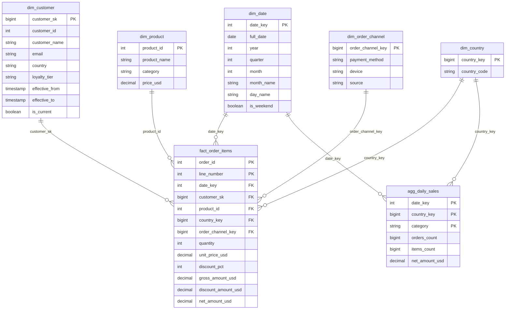
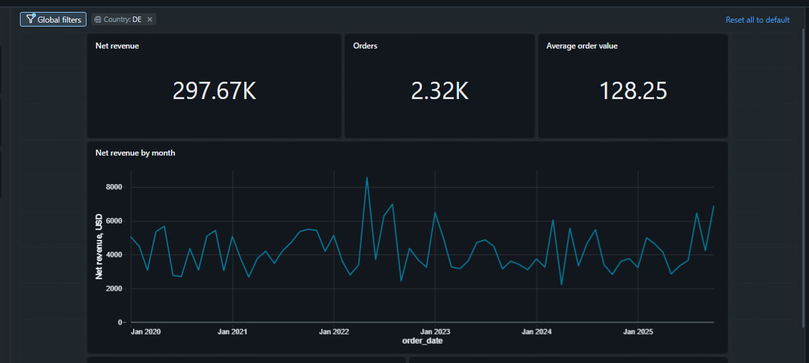
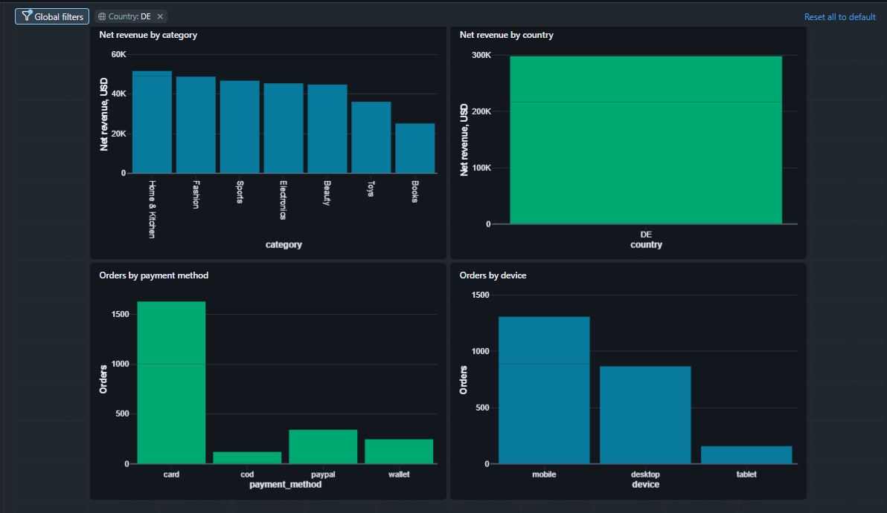
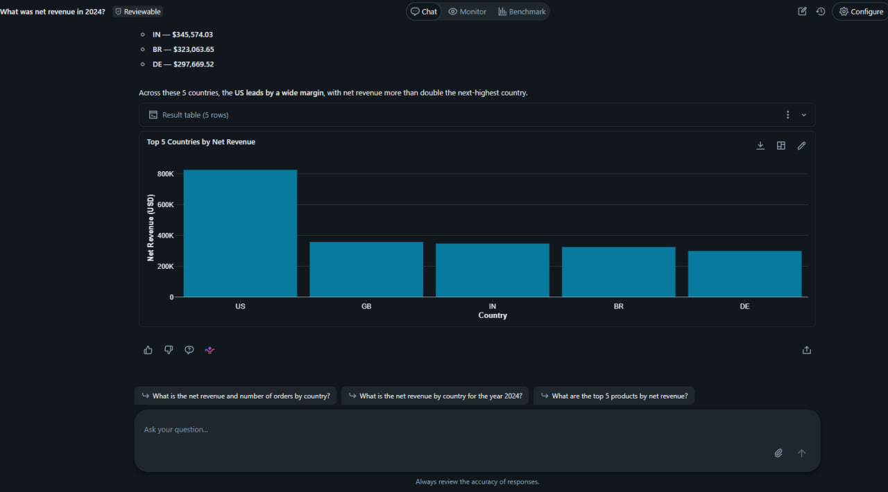

# Lab 6 — Gold Layer & Business Analytics

Gold star schema over e-commerce orders, an AI/BI dashboard with filters, a Genie space, a volume-drop alert with email notification, and governance with grants, row-level and column-level security.

Catalog: `dbr_dev_ua5816bd` · Schemas: `elina_sharabura_bronze` / `_silver` / `_gold` · 

## Notebooks

| Notebook | Purpose | Run |
|---|---|---|
| `00_setup_schema` | DDL for bronze, silver and gold tables (PK/FK, comments, clustering) | once |
| `01_bronze_order_items` | Auto Loader ingestion of `order_items.csv` with metadata columns | regular |
| `02_silver_orders` | Deduplication, validation, conditional MERGE, quarantine | regular |
| `03_silver_order_items` | Validation, referential checks, `line_number`, quarantine | regular |
| `04_gold_dim_date` | Static calendar 2020-01-01 … 2030-12-31 (range via parameters) | once |
| `05_gold_dims` | `dim_customer` (SCD2), `dim_product` | regular |
| `06_gold_fact_order_items` | Fact build with point-in-time customer join and quality gate | regular |
| `07_gold_aggregates` | `agg_daily_sales` from the fact | regular |
| `08_governance` | Access rules, row filters, column masks, grants | once |
| `sql/alert_volume_drop.sql` | Query behind the volume-drop alert | — |

All notebooks take `catalog` and `schema_prefix` as widgets. Loads are idempotent (`INSERT OVERWRITE` / conditional `MERGE`); DDL is kept out of the load notebooks.

## Star schema

Grain of the fact: **one product line within one order**.

Result: 59,163 order lines, 33,580 orders, net revenue $4,493,217.47.

## Key design decisions

- **Order-line grain.** `order_items.csv` was ingested in addition to `orders` so that products join to sales.
- **No deduplication of repeated `(order_id, product_id)`.** 110 pairs repeat with different quantities and sum exactly to the order subtotal, so they are real lines. A deterministic `line_number` forms the key.
- **SCD2 initial load.** Customer versions start at the moment tracking began (2026), while orders go back to 2020. In gold the first version of each customer is valid from `1900-01-01`, so historical orders find a version.
- **Point-in-time join.** The fact stores `customer_sk` of the version valid at order time.
- **Discount allocation.** Net amount is rounded per line and the rounding residual goes to the last line, so line totals reconcile with the order total to the cent.
- **`DECIMAL` in gold**, `DOUBLE` kept in bronze/silver for consistency with existing tables.
- **Static `dim_date`** loaded once for several years ahead; the fact quality gate fails if an order date is outside the calendar.
- **No order timestamp in the fact** (high cardinality, not used for analysis).
- **Quality gate** in the fact build: row count must match silver and every line must get a customer version.
- **Only measures and dimension keys in the fact.** Order country is a separate `dim_country` (also the anchor for row-level security); payment method, device and source form a junk dimension `dim_order_channel`. Dimension members are added with insert-only `MERGE`, so surrogate keys stay stable between runs.

## Dashboard, Genie, alert

- **Dashboard `Sales Overview`:** KPIs (net revenue, orders, average order value), revenue by month, category and country, orders by payment method and device. Global filters on order date, country and category, bound to both datasets. Order counts use `COUNT(DISTINCT order_id)` from the fact: summing `orders_count` from the aggregate overstates orders by 41%. Published with **individual data permission**, so row filters and masks apply to each viewer.
- **Genie space `Sales Q&A`:** fact and three dimensions only (the aggregate is excluded because of its non-additive `orders_count`), business definitions in instructions, example SQL.
- **Alert `lab6 - gold fact volume drop`:** latest month of order lines vs. the average of the three previous months; fires when the ratio is below 0.5. The threshold was calibrated on history (lowest normal ratio 0.79). Simulated by deleting ~80% of October 2025 lines: ratio 0.22, status Triggered, email notification sent; restored by re-running the fact notebook. Schedule is paused.

## Governance

- **`access_rules`** entitlement table: user, order country (`NULL` = all), PII permission. Users without a row see nothing.
- **Row-level security:** `rls_country_filter` on `fact_order_items` and `agg_daily_sales` by order country, so aggregates cannot bypass it.
- **Column-level security:** `cls_mask_pii` masks `customer_name` and `email` in `dim_customer`.
- **Grants:** `USE SCHEMA` and `SELECT` on gold business tables for `students`; `access_rules` is not granted. Reviewer has full access through `access_rules`.
- Verified by restricting the current user to `DE` without PII: tables and the dashboard (with no filters set) show only Germany, PII columns show `***`.

Screenshots: [`screenshots/`](screenshots/)
