# Lab 7 — Data Quality Testing & Unit Tests

Unit tests check the **code**, data-quality checks check the **data**. This lab adds both to the orders pipeline from Lab 6
and to the reviews pipeline from Lab 5. The `lab5/` and `lab6/` folders are not changed.

## Environment

| | |
|---|---|
| Workspace | trial `dbr_dev_ua_5816_trail_3` |
| Catalog / schemas | `dbr_dev_ua5816bd` / `elina_sharabura_bronze`, `_silver`, `_gold` |
| Deployment | Declarative Automation Bundle, target `trial` |

## Structure

```
lab7/
├── src/orders_pipeline/       # importable logic
│   ├── silver.py              #   dedup, validation rules, line numbers, quarantine records
│   ├── gold.py                #   dimensions, date key, discount allocation, SCD2 join, fact
│   └── quality.py             #   DQX result summary, reconciliation, gate
├── tests/                     # pytest unit tests
├── notebooks/                 # job notebooks: read -> call src -> write
├── pipelines/reviews/         # Lakeflow pipeline with expectations and quarantine
├── dq/checks.yml              # DQX rules per table
├── setup/                     # one-off DDL, run manually
├── resources/                 # lab7_load, lab7_reviews_pipeline, lab7_dq_suite
└── screenshots/
.github/workflows/lab7-ci.yml  # unit-test CI
```

## Part A — Unit tests

### Modules
The transformation logic of the Lab 6 silver and gold notebooks was moved into the `orders_pipeline` package as pure
`DataFrame -> DataFrame` functions. The `lab7_load` notebooks only read tables, call these functions and write the result,
so the tested code is the same code that loads the data.

### Tests
16 tests on small hand-made DataFrames, no real tables:

| Type | Tested behaviour |
|---|---|
| Derivation | latest version per key, line numbers within an order, discount allocated per line with the rounding residual on the last line |
| Parsing | `order_time` -> `date_key` |
| Joins | customer version valid at order time (SCD2), full fact build with all dimension keys |
| Validation | failed rules per row, unknown references, rescued data |
| Data quality | DQX result summary, money sums, reconciliation, gate |

The tests found a silent data-loss bug in the Lab 6 deduplication: `row_number()` over `order_id` collapsed all rows with a
NULL `order_id` into one. `keep_latest` now keeps them, so they reach the quarantine.

### Where the tests run

| Where | Spark | Command |
|---|---|---|
| VS Code / terminal | Databricks serverless via Databricks Connect | `pytest --cov` |
| GitHub Actions | local PySpark | `.github/workflows/lab7-ci.yml` on every push and pull request |

CI fails when a test fails or coverage drops below 90% (current coverage: 95%).
CI runs only unit tests: data-quality checks run as a separate Databricks job (Part B).

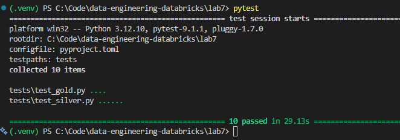
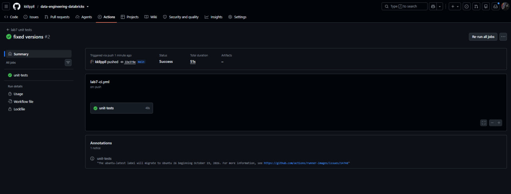
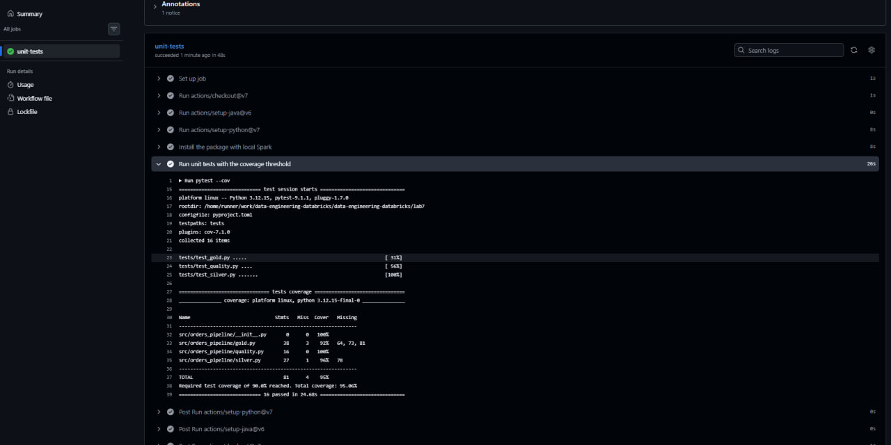

## Part B — Data quality

| Layer | Where | What it does |
|---|---|---|
| In-pipeline gate | `lab7_reviews_pipeline` (Lakeflow) | fail / drop / warn expectations; dropped rows go to a quarantine table with the rules they break |
| In-pipeline gate | `lab7_load` (orders) | rows breaking silver rules go to `silver.dq_quarantine` with `failed_rules` |
| Table constraints | Delta `NOT NULL` + `CHECK` | invalid writes are rejected by the table |
| DQ suite | `lab7_dq_suite` (DQX + reconciliation) | measures all layers, stores results in `dq_results`, fails on any `error` check |

### Load job
`lab7_load`: bronze order items (Auto Loader) -> silver orders and order items -> gold dimensions -> fact.
The job uses parameters from the bundle; the schedule is configured and paused.

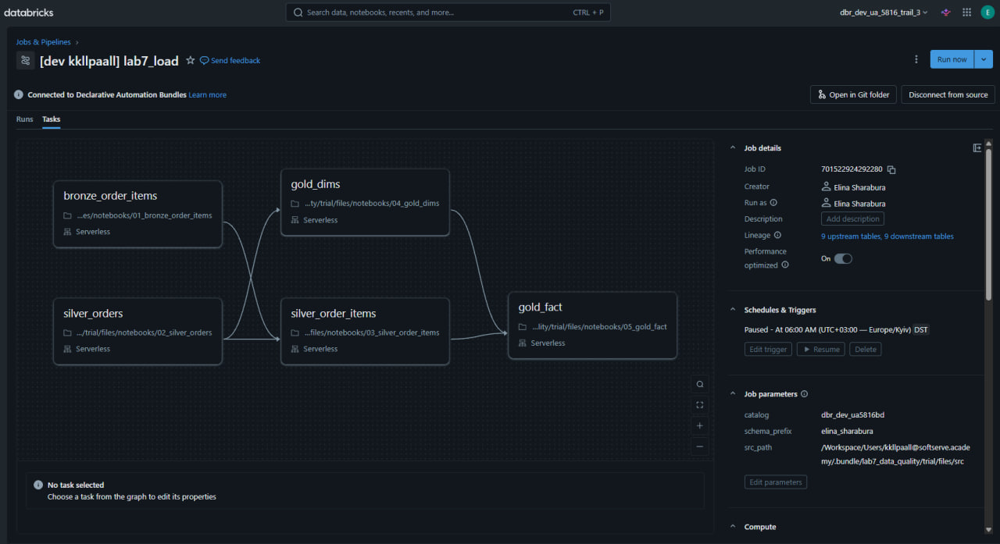

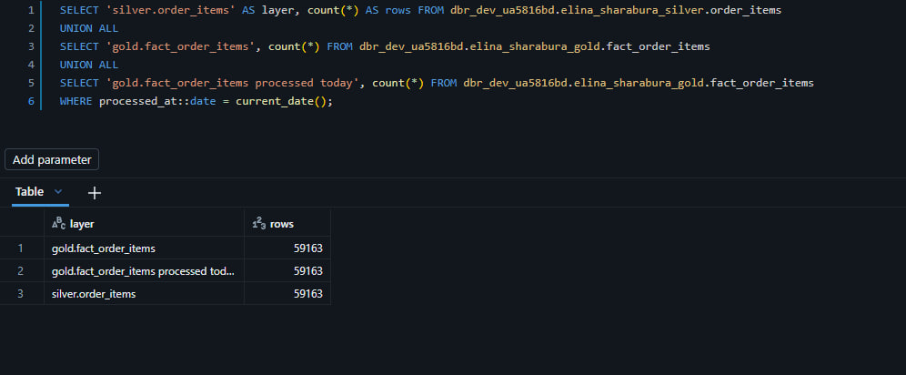

### Lakeflow expectations and quarantine
Rules are grouped by action (`FAIL_RULES`, `DROP_RULES`, `WARN_RULES`). The quarantine table is built from the same drop rules,
so a rule cannot be added to the expectations and forgotten in the quarantine.

Result: bronze 10 786 = silver 10 782 + quarantine 4.

The pipeline writes to `reviews_v2` tables: a Lakeflow table belongs to the pipeline that created it, and the Lab 5 pipeline
stays unchanged.

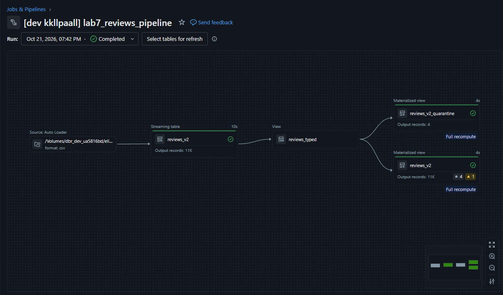
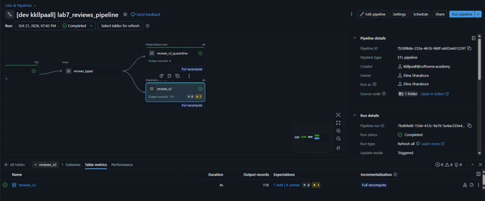
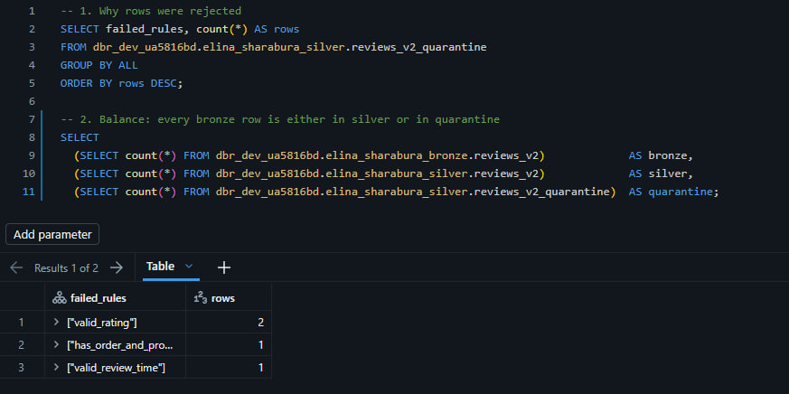
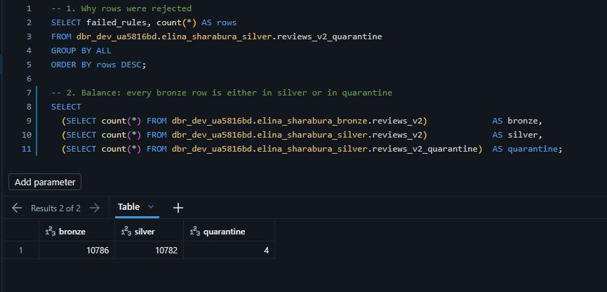

### Delta constraints
`setup/02_delta_constraints.py` adds `NOT NULL` to amounts and quantities and `CHECK` constraints to silver orders and order items.
A `CHECK` passes when its condition is NULL, so every column used in a `CHECK` is also `NOT NULL`.

`CHECK` constraints are not supported on tables with row filters. The fact has the Lab 6 row filter, so its rules are asserted
in the DQ suite instead.

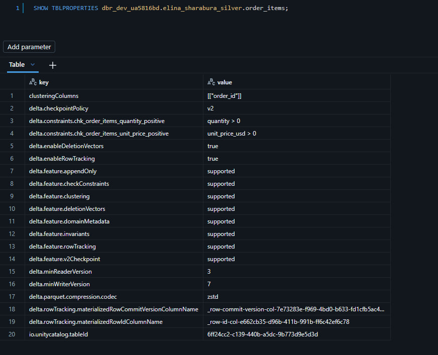
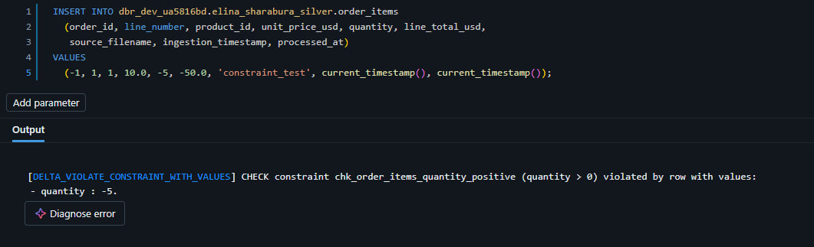
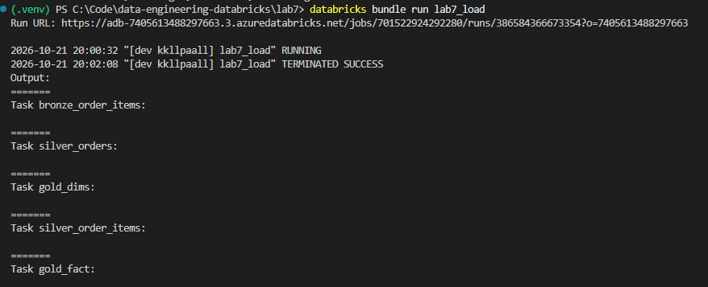

### DQ suite
`lab7_dq_suite` applies the DQX rules from `dq/checks.yml` to bronze, silver and gold and reconciles the layers.
Bronze checks only warn: raw data may be dirty, and silver quarantines it.

| Dimension | Checks |
|---|---|
| Completeness | keys are not null in bronze |
| Uniqueness | `order_id`; `(order_id, line_number)`; one current SCD2 version per customer |
| Validity | accepted payment methods, devices and sources; ISO-2 country; quantity and discount ranges |
| Consistency | total vs discount; line total vs price × quantity; net = gross − discount; foreign keys from the fact to all dimensions |
| Timeliness | fact loaded within the last 24 hours |
| Reconciliation | bronze = silver + quarantine; silver = gold in rows, gross and net amounts |

Result: 32 of 32 checks passed. Gold keeps every order line and every cent of silver
(gross 4 835 608.22, net 4 493 217.47).

Every run appends one row per check to `elina_sharabura.dq_results`. Results are written before the gate,
so failed runs stay in the history. The job emails the owner on failure.

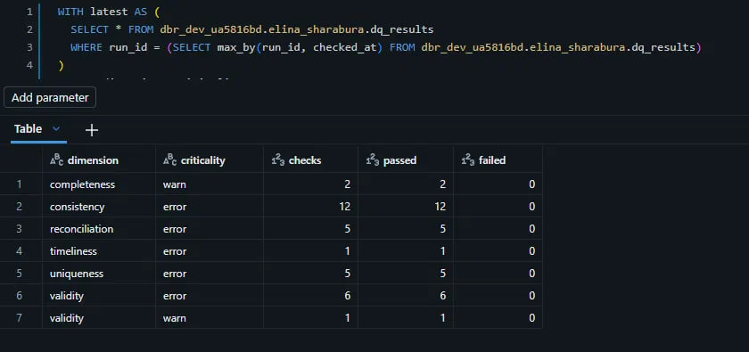
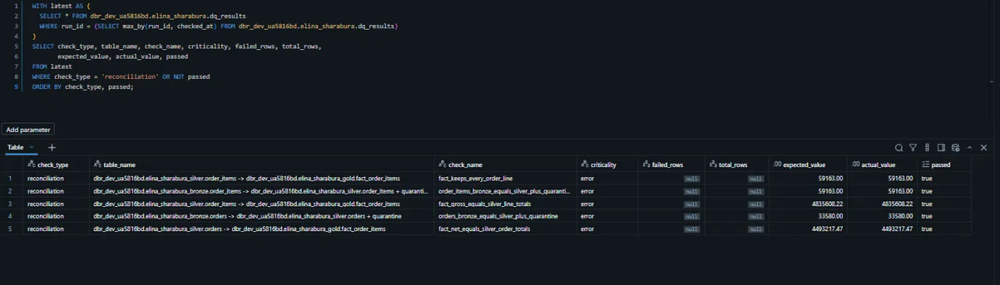

### Gate check
One silver order line was deleted to simulate silent data loss. The suite failed on four reconciliation checks
(rows bronze -> silver, rows silver -> gold, $107.15 gross, $85.72 net). `lab7_load` restored the row, and the suite passed again.

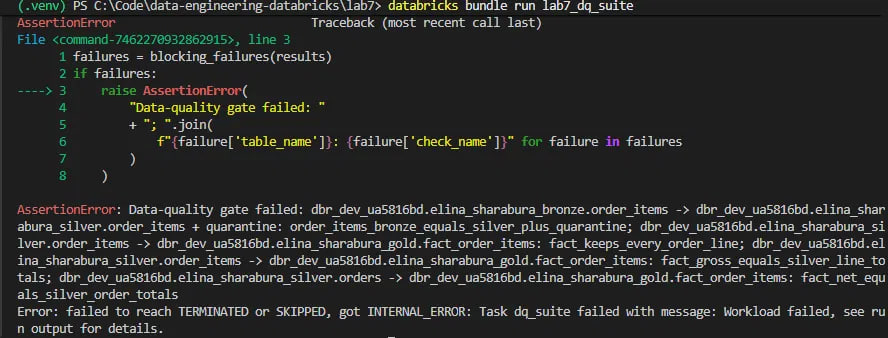
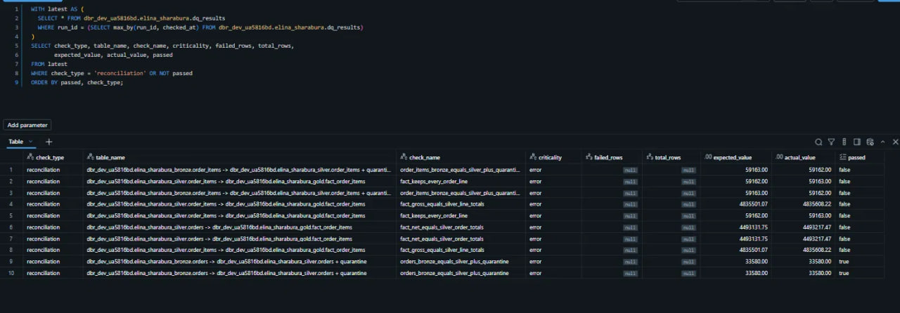
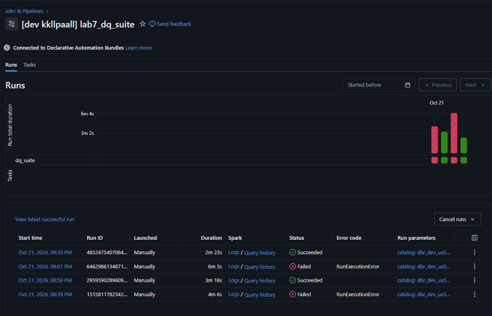
