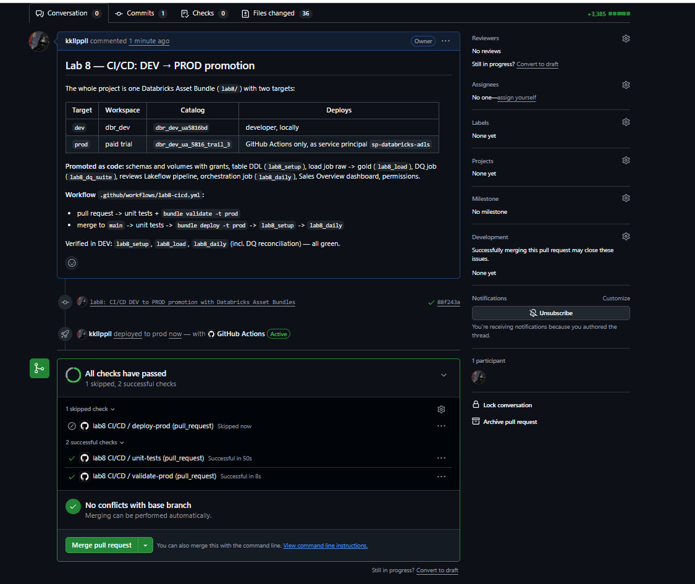
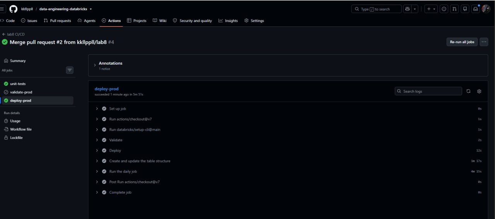
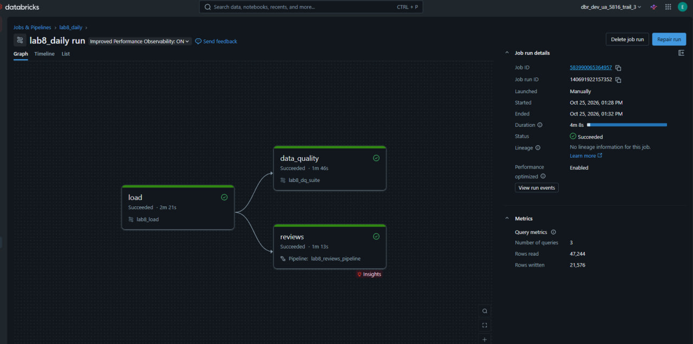
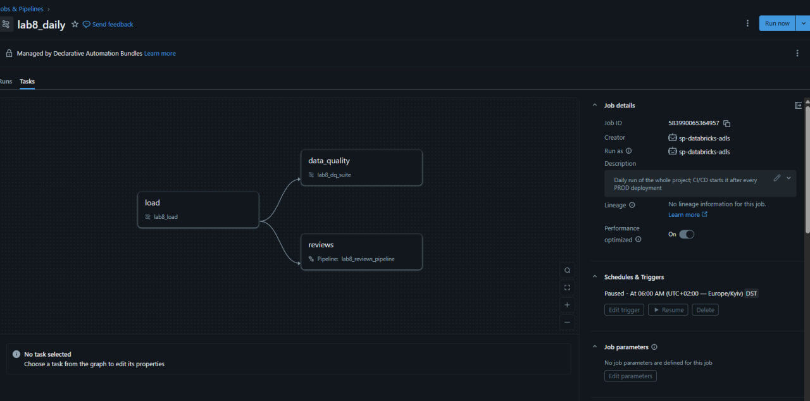
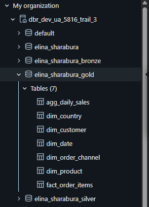
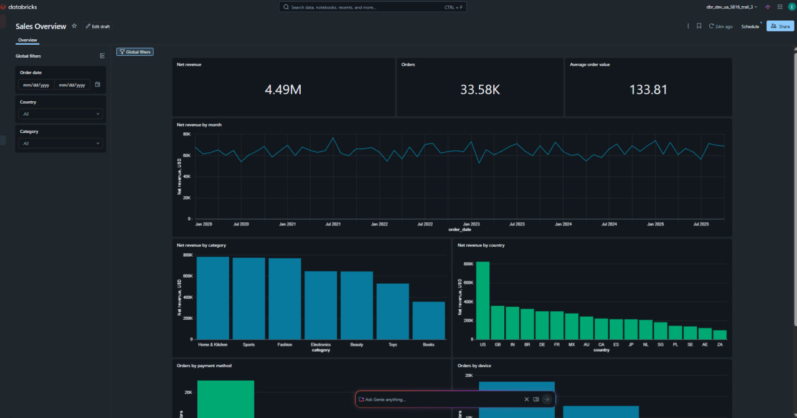
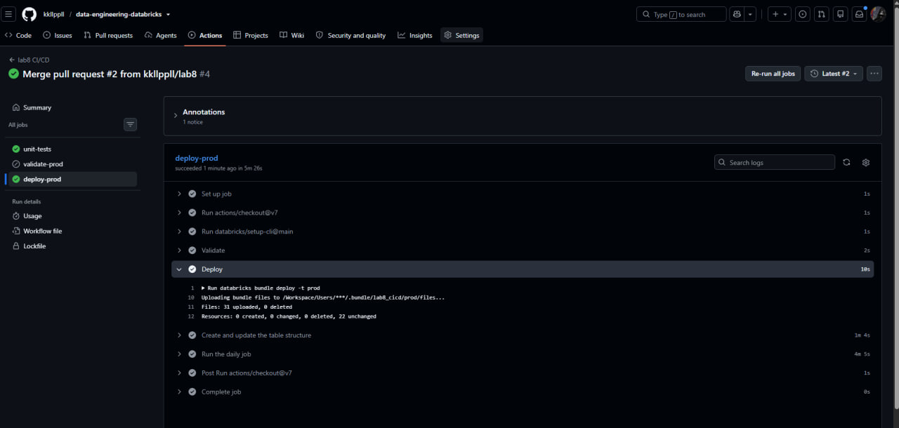

# Lab 8 — CI/CD: DEV → PROD Promotion

The orders project from Labs 4–7 is one Declarative Automation Bundle (Databricks Asset Bundle) with two targets.
A merge to `main` deploys it to the paid PROD workspace and runs it with no manual steps.
PROD is changed only by GitHub Actions, authenticated as a service principal.

## Environments

| | DEV | PROD |
|---|---|---|
| Target | `dev` (default) | `prod` |
| Workspace | `dbr_dev` `adb-7405604651938730` | paid trial `adb-7405613488297663` |
| Catalog | `dbr_dev_ua5816bd` | `dbr_dev_ua_5816_trail_3` |
| Schemas | `elina_sharabura`, `_bronze`, `_silver`, `_gold`  | same names, created by the bundle |
| Mode | `development`: `[dev kkllpaall]` prefix, paused schedules | `production` |
| Deployed by | developer, from the laptop | GitHub Actions only |
| Runs as | developer | service principal `sp-databricks-adls` |

The code is the same in both environments. Everything that differs is a bundle variable set in the target:
the catalog and, for the reviews tables, the table name. Notebooks get these values as job parameters.

## Structure

```
lab8/
├── databricks.yml        # bundle: variables, dev and prod targets, PROD schemas, volumes, grants, permissions
├── resources/            # jobs, pipeline, dashboard
├── setup/                # DDL, run by the lab8_setup job
├── notebooks/            # job notebooks: read -> call src -> write
├── pipelines/reviews/    # Lakeflow pipeline with expectations and quarantine
├── src/orders_pipeline/  # tested transformation and validation logic
├── dq/checks.yml         # DQX rules
├── dashboards/           # Sales Overview dashboard
└── tests/                # pytest unit tests
.github/workflows/lab8-cicd.yml
```

Orders are processed by notebooks in jobs (as in Labs 4, 6 and 7), reviews by a Lakeflow pipeline (as in Labs 5 and 7).
Both are deployed by the same bundle.

## Everything as code

| Object | Where | How it reaches PROD |
|---|---|---|
| Schemas, volumes `raw_data` and `checkpoints` | `databricks.yml`, `prod` target | bundle resources; `prevent_destroy` on schemas |
| Unity Catalog grants | `databricks.yml`, `grants` on schemas | bundle resources |
| Tables, constraints, `dim_date` | `setup/`, job `lab8_setup` | CI runs the job after every deployment |
| Load raw -> gold | `notebooks/`, job `lab8_load` | bundle resource |
| Data quality | `notebooks/06_dq_suite.py`, `dq/checks.yml`, job `lab8_dq_suite` | bundle resource |
| Reviews pipeline | `pipelines/reviews/`, `lab8_reviews_pipeline` | bundle resource |
| Orchestration | job `lab8_daily` | bundle resource; CI runs it after every deployment |
| Dashboard and its queries | `dashboards/sales_overview.lvdash.json` | bundle resource |
| Job, pipeline and dashboard permissions | `databricks.yml`, `permissions` | bundle |

The schemas are created by the service principal, so it owns them; the developer gets read access through `grants`.
In DEV the schemas already exist, so they are defined only in the `prod` target.

The dashboard queries use bare table names; `dataset_catalog` and `dataset_schema` point them at the catalog of the target,
so the PROD dashboard reads PROD data. The SQL warehouse is found by name (`lookup`), no IDs are hardcoded.

## Jobs

```
lab8_daily (schedule 06:00 Kyiv, paused)
├── load          -> lab8_load
├── reviews       -> lab8_reviews_pipeline   (after load)
└── data_quality  -> lab8_dq_suite           (after load)
```

**`lab8_setup`** - structure only: `create_tables` -> `add_constraints`, `load_dim_date`. No schedule.
DDL is kept out of the data jobs, as recommended in the Lab 4 and Lab 6 reviews.

**`lab8_load`** - data only:

```
copy_raw_files -> bronze_orders, bronze_customers, bronze_products, bronze_order_items
               -> silver_products (SCD1), silver_customers (SCD2) -> silver_orders -> silver_order_items
               -> gold_dims -> gold_fact -> gold_aggregates
```

- `copy_raw_files` copies the project's CSV files from the DEV landing volume into the raw volume of the target.
  Only files that are not there yet are copied. In DEV the landing volume is the raw volume, so nothing is copied.
  `events.csv` from Lab 3 is not part of the project and is not copied.
- Bronze: Auto Loader. Orders, customers and products share one notebook (`08_bronze_ingest`) with different parameters.
- Silver: every table validates against named rules from `src/orders_pipeline/silver.py`;
  rejected rows go to `silver.dq_quarantine` with the rules they break.

**`lab8_dq_suite`** — the Lab 7 suite: DQX rules on all layers and reconciliation
(bronze = silver + quarantine; gold keeps every line and cent of silver). Fails on any `error` check.

The schedule is configured but paused, because the course workspaces are shared.

## CI/CD

`.github/workflows/lab8-cicd.yml`:

| Event | Jobs |
|---|---|
| pull request to `main` | `unit-tests` -> `validate-prod` (`bundle validate -t prod` as the service principal) |
| merge to `main` | `unit-tests` -> `deploy-prod`: validate -> `bundle deploy -t prod` -> `bundle run lab8_setup` -> `bundle run lab8_daily` |

- The run fails if the deployment fails or if a deployed job fails, including a blocking data-quality check.
- `deploy-prod` runs one at a time (`concurrency`); a newer merge waits.
- `deploy` runs without `--auto-approve`, so a change that would delete resources stops and needs a human.
- The Databricks CLI version is pinned (`1.20.0`, the version used locally).
- Branch protection on `main`: changes only through a pull request, and `unit-tests` and `validate-prod` must pass.
- Data quality is not part of CI: CI checks the code, the DQ job checks the data.

### Authentication

GitHub Actions signs in as the service principal `sp-databricks-adls` (Microsoft Entra ID, `azure-client-secret`).
Its credentials come from the course Key Vault and are stored in the GitHub environment `prod`:
`ARM_TENANT_ID`, `ARM_CLIENT_ID`, `ARM_CLIENT_SECRET`. Only the jobs that use `environment: prod` can read them.

Personal access tokens are disabled for the developer in the PROD workspace, and the developer cannot write to PROD:
a local `bundle validate -t prod` fails with `403 PERMISSION_DENIED`. Only CI can deploy.

### One-time bootstrap

These steps prepare the platform for CI/CD and cannot be done by the bundle itself:

1. Created the GitHub environment `prod` with the three secrets above.
2. Granted the service principal read access to the DEV landing volume:
   ```sql
   GRANT USE SCHEMA ON SCHEMA dbr_dev_ua5816bd.elina_sharabura TO `<sp application id>`;
   GRANT READ VOLUME ON VOLUME dbr_dev_ua5816bd.elina_sharabura.raw_data TO `<sp application id>`;
   ```
3. Enabled branch protection on `main`.

The service principal was already added to the PROD workspace with `CREATE SCHEMA` on the PROD catalog.
After the bootstrap nothing in PROD is created or changed by hand.

## Idempotency

- `bundle deploy` compares the code with the deployment state and applies only the difference.
  A repeated deployment of the same commit: `Resources: 0 created, 0 changed, 0 deleted, 22 unchanged`.
- DDL: `CREATE TABLE IF NOT EXISTS`; each `CHECK` constraint is dropped and added again; `dim_date` is `INSERT OVERWRITE`.
- Auto Loader does not read a file twice; `copy_raw_files` copies only new files.
- Silver uses `MERGE`; gold dimensions and the fact are overwritten, identity dimensions are merged.
- The DQ suite reconciles the layers on every run, so a duplicate or a lost row fails the job.

**Check:** the workflow run was started again for the same commit. It was green, the deployment changed nothing,
and the data-quality suite passed again.

## Decisions

- **Separate PROD catalog and workspace.** A clean environment proves that the project does not depend on anything created by hand.
  In PROD the whole medallion is built from the raw CSV files.
- **Data reaches PROD by copying from the DEV landing volume.** In a real system the source would write to the PROD landing zone;
  here the DEV volume plays that role. The path is a bundle variable.
- **Grants to the owner, not to a group.** The first deployment failed with `Principal: GroupName(students) does not exist`:
  the group exists in DEV but not in the PROD workspace. The fix went through a pull request like any other change.
- **Reviews tables have their own name in DEV.** In DEV the `reviews` and `reviews_v2` tables belong to the Lab 5 and Lab 7 pipelines,
  and a Lakeflow table can be written only by the pipeline that created it. The name is a variable:
  `reviews` in PROD, `reviews_lab8` in DEV.
- **Row filter and column masks from Lab 6 are not promoted.** Permissions are covered by Unity Catalog grants and bundle permissions.
- **Event Hub streaming from Labs 3 and 5 is not promoted.** Its producer runs outside Databricks, on the laptop.

## Changes after earlier reviews

- DDL is in its own job, not in the data jobs; table existence is not checked in the code.
- Bronze uses Auto Loader.
- `dim_date` is a separate script loaded for several years ahead (2020–2030).
- Loading and data quality are separate jobs; unit tests run only in CI.
- Jobs get the catalog and schema as parameters; widgets have no default values, so a job cannot silently write to another environment.
- No `print` in the notebooks; the schedule is configured and paused.


The `prod` target is deployed only by CI.

## Screenshots

Pull request checks:


Deployment to PROD after the merge:


Job run in PROD:


The job is managed by the bundle and runs as the service principal:


PROD schemas and tables:


Dashboard in PROD:


Repeated deployment of the same commit:
