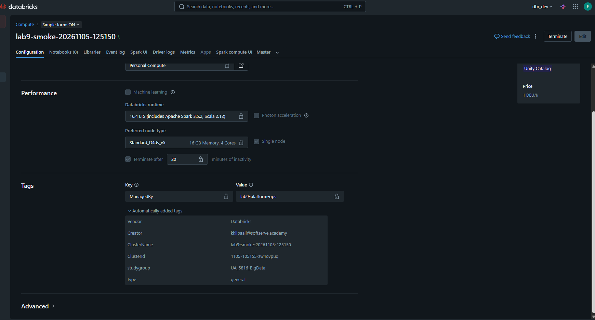
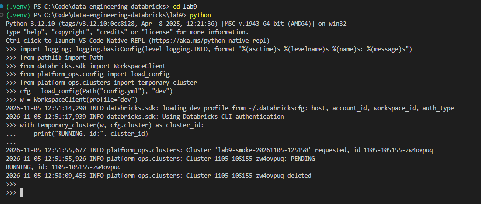
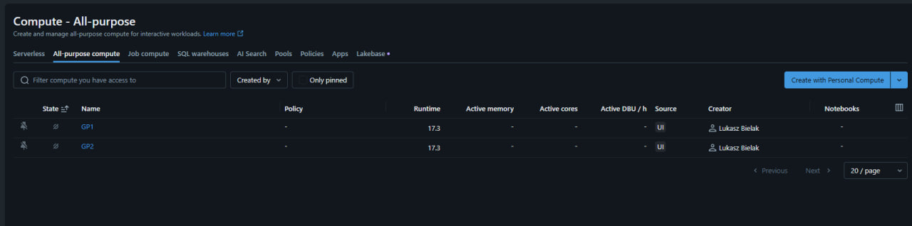
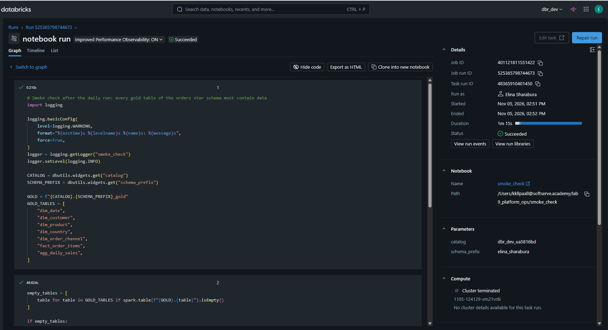
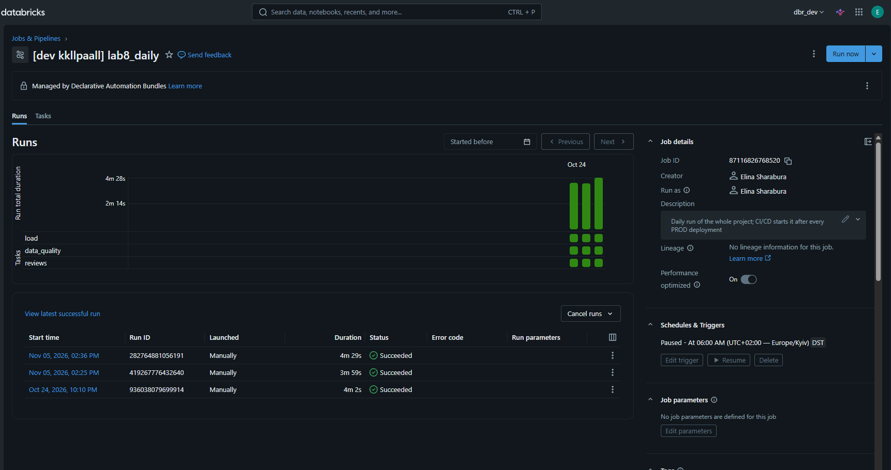
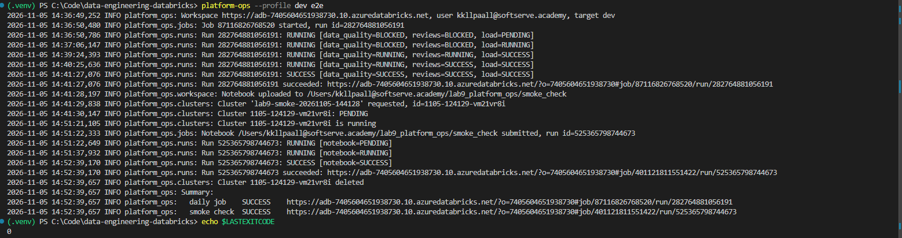
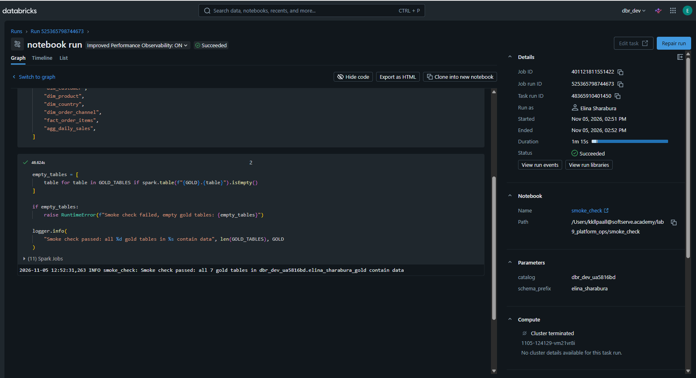
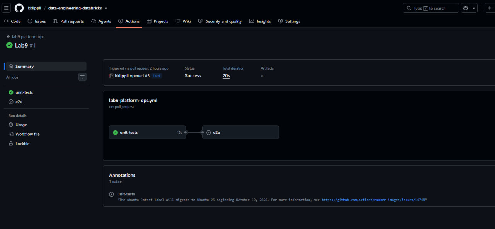
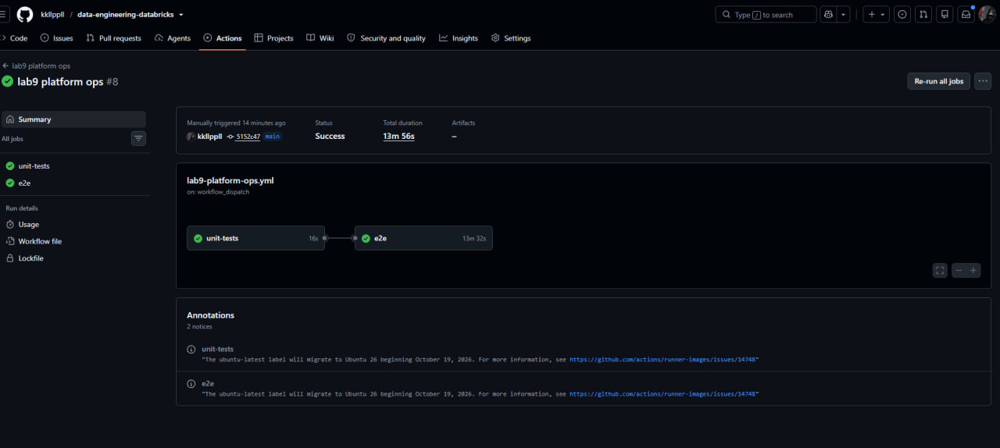
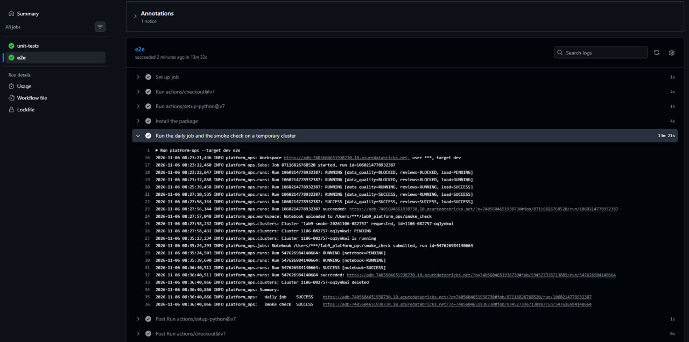

# Lab 9 — Databricks REST API Automation

`platform-ops` is a small CLI on the Databricks Python SDK, which calls the Databricks REST API.
It runs the deployed daily job of the orders project, then provisions a temporary cluster,
runs a smoke-check notebook on it, reports the status of every step and deletes the cluster.
GitHub Actions runs its unit tests on every pull request and the end-to-end scenario on `main`.

## Environment

Lab 9 works in `dbr_dev` (`adb-7405604651938730`). 
The script drives the DEV deployment of the Lab 8 bundle: the job `[dev kkllpaall] lab8_daily`
and the gold tables in `dbr_dev_ua5816bd.elina_sharabura_gold`. 


## End-to-end scenario

```
platform-ops e2e
│
├── lab8_daily (load -> reviews, data_quality)     jobs/run-now, polled until it ends
│     only if it succeeded:
├── temporary cluster                              clusters/create under the Personal Compute policy
├── smoke_check notebook on that cluster           workspace/import + jobs/runs/submit
├── cluster deleted, also after a failure          clusters/permanent-delete
└── summary of every step, exit code 0 or 1
```

The cluster is created only after the job has succeeded: it does not wait idle while the job runs,
and it is not created at all when there is nothing to check.

## Commands

```
platform-ops [--target dev] [--profile PROFILE] [--config PATH] <command>
```

| Command | What it does |
|---|---|
| `e2e` | the whole scenario above |
| `run-job` | runs the daily job and waits for it |
| `smoke-check` | temporary cluster, smoke-check notebook, cluster deleted |
| `status <run_id>` | final state of any run; waits if it is still running |

- `--target`: section of `config.yml` (default `dev`).
- `--profile`: Databricks CLI profile. Without it the SDK reads environment variables; this is how CI signs in.
- Exit code `0` when every step succeeded, `1` when a step failed or an error occurred, `2` for wrong arguments.

## API calls

| Operation | SDK | REST endpoint |
|---|---|---|
| Who am I | `current_user.me` | `GET /preview/scim/v2/Me` |
| Find the job by name | `jobs.list(name=...)` | `GET /jobs/list` |
| Start the job | `jobs.run_now` | `POST /jobs/run-now` |
| Find the cluster policy by name | `cluster_policies.list` | `GET /policies/clusters/list` |
| Create the cluster and wait until it runs | `clusters.create(...).result()` | `POST /clusters/create`, `GET /clusters/get` |
| Upload the notebook | `workspace.mkdirs`, `workspace.upload` | `POST /workspace/mkdirs`, `POST /workspace/import` |
| One-time notebook run on the cluster | `jobs.submit` | `POST /jobs/runs/submit` |
| Run state and failure details | `jobs.get_run`, `jobs.get_run_output` | `GET /jobs/runs/get`, `GET /jobs/runs/get-output` |
| Delete the cluster | `clusters.permanent_delete` | `POST /clusters/permanent-delete` |

## Structure

```
lab9/
├── pyproject.toml                 # package, pinned databricks-sdk, the platform-ops command
├── config.yml                     # per target: job name, cluster policy and size, smoke-check catalog and schema
├── notebooks/smoke_check.py       # runs on the temporary cluster: every gold table must contain data
├── src/platform_ops/
│   ├── cli.py                     # commands, logging, summary, exit code
│   ├── config.py                  # typed configuration, fails fast on an unknown target or a missing key
│   ├── clusters.py                # temporary cluster: create, wait, always delete
│   ├── workspace.py               # uploads the notebook to the caller's home folder
│   ├── jobs.py                    # job by name, run-now, one-time notebook run
│   └── runs.py                    # polls a run, logs state changes, collects failure reasons
└── tests/test_platform_ops.py     # unit tests with a mocked WorkspaceClient
.github/workflows/lab9-platform-ops.yml
```

## How it works

**No IDs in code or config.** The job and the cluster policy are found by name; the search stops with an error
if it finds none or more than one, so a job with the same name cannot be started by mistake.
The runtime is the latest LTS (`select_spark_version`), and the notebook path is built from the current user.
`config.yml` holds only names and sizes.

**Temporary cluster.** Single node `Standard_D4ds_v5` under the `Personal Compute` policy, dedicated access mode
for Unity Catalog, Photon off, auto-termination after 20 minutes, tag `ManagedBy: lab9-platform-ops`.
It is a context manager: `permanent_delete` runs in `finally`, so the cluster is removed when the notebook fails
or when the cluster never starts. Auto-termination is the safety net if the script itself is killed.

**Notebook.** The script uploads `smoke_check.py` with `overwrite`, so the workspace always has the version from git,
and runs it once with `runs/submit`: no job object is created, jobs stay owned by the Lab 8 bundle.
The catalog and schema are passed as notebook parameters from `config.yml`.

**Smoke check, not data quality.** `lab8_daily` already runs the data-quality suite. The smoke check only answers
"did the run produce a result": each of the 7 gold tables (`dim_date`, `dim_customer`, `dim_product`, `dim_country`,
`dim_order_channel`, `fact_order_items`, `agg_daily_sales`) must exist and contain data.
Otherwise the notebook raises and the run fails.

**Monitoring.** The script polls a run every 15 seconds and logs only changes, with the state of every task,
e.g. `RUNNING [data_quality=BLOCKED, reviews=BLOCKED, load=RUNNING]`. Only `result_state = SUCCESS` counts as success;
`TERMINATED` alone is not. For a failed run the error of every failed task is read with `runs/get-output`.
Timeouts: 60 minutes for the job; 30 minutes for the notebook run on the Databricks side and 35 minutes locally,
so a hanging notebook is stopped by Databricks and reported as `TIMEDOUT`.

**Logging.** `logging` instead of `print`, both in the CLI and in the notebook. The root logger stays at `WARNING`,
so library logs (py4j, the SDK) do not flood the output.

**Authentication.** SDK unified authentication: locally `--profile dev` (OAuth login of the developer),
in CI the environment variables of the service principal. No credentials in the code or in `config.yml`.

## CI/CD

`.github/workflows/lab9-platform-ops.yml`:

| Event | Jobs |
|---|---|
| pull request with changes in `lab9/` | `unit-tests` |
| merge to `main`, manual run | `unit-tests` -> `e2e`: `platform-ops --target dev e2e` as the service principal |

- `e2e` does not run on pull requests: it takes about 15 minutes and starts a real job and a cluster.
- `e2e` uses the GitHub environment `prod`, where the service principal credentials from Lab 8 are stored,
  runs one at a time (`concurrency`) and has a 90-minute timeout.
- The Lab 8 workflow is not changed.


### One-time bootstrap

In CI the script runs as the service principal `sp-databricks-adls`. It needs three permissions in `dbr_dev`
that the script itself does not grant:

1. **Run the job:** `CAN_MANAGE_RUN` on `[dev kkllpaall] lab8_daily`. The job is managed by the Lab 8 bundle,
   so the UI does not allow editing its permissions; the permission was added with
   `databricks permissions update jobs <job_id> --json @perm.json`. A new `bundle deploy -t dev` of Lab 8 may reset it.
2. **Read gold:** `USE SCHEMA` on `elina_sharabura_gold` and `SELECT` on the seven business tables.
   `access_rules` is not granted, as for the reader group in Lab 6.
3. **Row-level security:** a row in `access_rules` for the application ID of the service principal:
   all countries, `can_see_pii = false`. Without it the Lab 6 row filter returns no rows of `fact_order_items`
   and `agg_daily_sales` to the service principal.

Creating the cluster needs no extra grant: the `Personal Compute` policy is available to the service principal.


## Unit tests

`pytest` in `lab9/`, about 2 seconds, no workspace needed:

- polling ends with success;
- `TERMINATED` with `FAILED` is not success, and the failed task is named;
- waiting stops with a timeout;
- the job search refuses to guess when it finds no job or two jobs;
- the cluster is deleted when the work on it fails;
- `e2e` skips the smoke check when the job fails and exits with `1`.

## Run locally

```powershell
cd lab9
py -3.12 -m venv .venv
.\.venv\Scripts\Activate.ps1
pip install -e ".[test]"
pytest
databricks auth login --profile dev
platform-ops --profile dev e2e
```


## Screenshots

Temporary cluster created by the script:


Cluster lifecycle in the log:


The cluster is permanently deleted afterwards:


Smoke-check notebook run on the temporary cluster, with its parameters:


`lab8_daily` started through the API:


`platform-ops e2e` end to end, exit code 0:


What the smoke check verified:


Pull request: unit tests passed, `e2e` skipped:


`e2e` in CI as the service principal, both jobs green:


The same run: the summary of every step:
